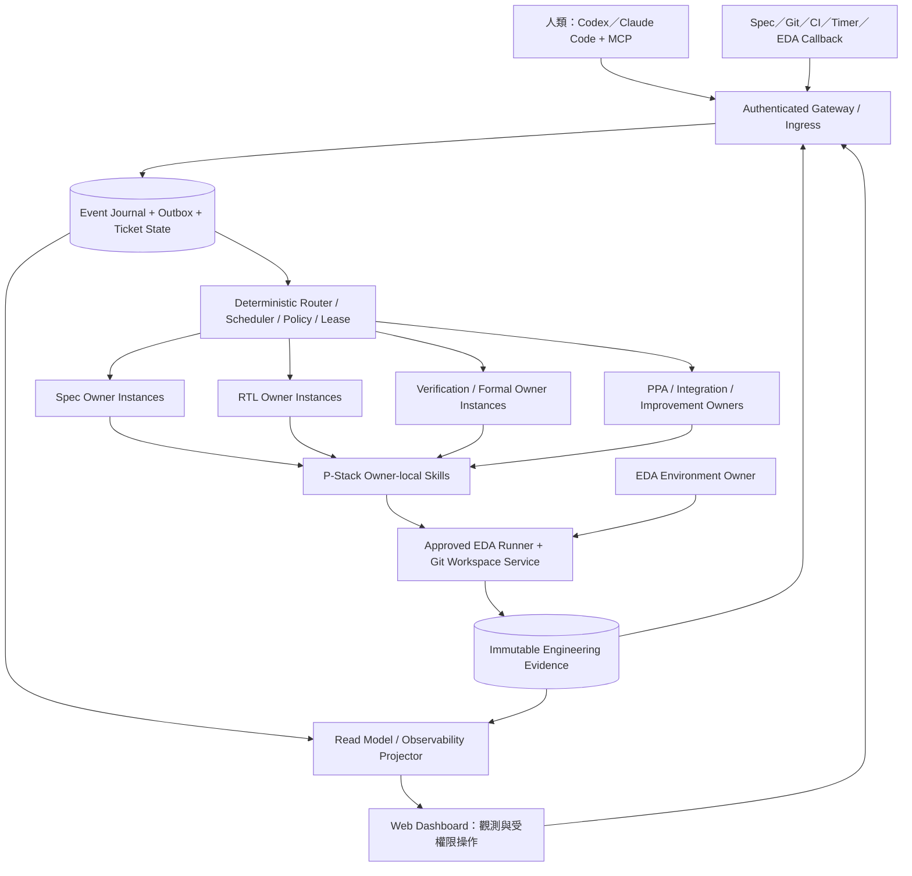
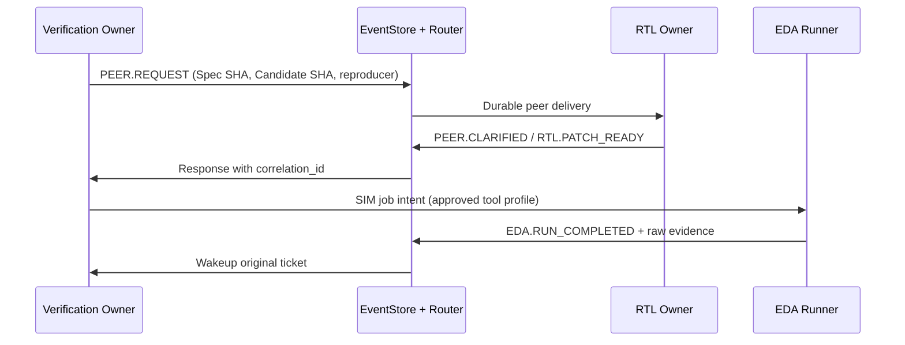

# SiliconForge v3.1：事件驅動晶片工程 Super Agent 完整架構規格書

**人類閱讀整合版 | Architecture & System Specification | 2026 年 11 月 10 日**

> **文件定位**：本文件把 SiliconForge 正式 Repository 的 v3.0 核心架構、v3.1 平行探索擴充、Dashboard／PDCA 規範及正式驗收要求重新編排為可連續閱讀的系統規格書。它是供架構審查與跨領域溝通的**閱讀整合版**，不擅自取代原始規範、授權政策、實際程式碼或動態工作指引。當摘要和正式規格有差異，原文件與其機器可讀契約優先。
>
> **規格快照**：唯一正式 Repository [`caseykcc0124/SiliconForge`](https://github.com/caseykcc0124/SiliconForge)，GitHub main 截至 Commit [`f99078a9ebd5a10ae3f15b500cec71f4fad41f13`](https://github.com/caseykcc0124/SiliconForge/commit/f99078a9ebd5a10ae3f15b500cec71f4fad41f13)。資料擷取於 2026-11-10 台灣時間。此版本名稱「人類閱讀整合版 1.0」不是新的專案架構版號。
>
> **閱讀規則**：本文件將「**設計要求**」、「**允許的實作方式**」、「**本地 Agent 已回報**」和「**正式驗收**」明確區分。開發成果未經取得原始 Source、執行紀錄與相應 Gate 證據前，不得因架構圖完整而標示量產級或正式 PASS。

## 00｜從一項工程變更開始理解 SiliconForge

想像一個晶片 IP 的規格修改：APB CRC32 的某個暫存器行為發生變化。傳統流程中，工程師要通知 RTL 設計者，協調 Verification 更新測試，排隊跑模擬與 Formal，接著將結果交給架構、PPA 與整合團隊；任何一個人停在訊息交換或環境問題上，都可能讓整條工作鏈等待。

SiliconForge 的目標是把這條鏈路變成**事件觸發、可稽核、會恢復的數位工程組織**。規格變化進入認證入口後，系統將任務持久化並交給對應的 Domain Owner。Owner 依自己的工程專長與 P-Stack 方法工作，必要時把請求直接交給其他 Owner；EDA Runner 執行受控工具；工具與 Agent 的結果再形成事件，驅動後續步驟。即使使用者關閉 Codex 或 Dashboard，已提交的工作與證據也不應消失。

這個願景受三條限制支配。第一，**Runtime 負責程序及權限，專業 Owner 負責工程判斷**。第二，**只有符合同一規格、原始碼、約束及環境版本的真實證據，才能形成工程驗收**。第三，**同一需求可以衍生多個競爭的設計方案，但每條方案都必須獨立可追溯、可終止、可驗證**。第三項正是 v3.1 相較 v3.0 的主要擴充。

初始基準使用小型 APB CRC32 Engine，足以涵蓋 APB 協定、寄存器語意、reset、資料運算、功能驗證、Formal 與 PPA；不以整顆大型 SoC 作為首個閉環的先決條件。未來才逐步擴展其他 IP 與多專案。

## 01｜目標、系統邊界與成功定義

**正式目標**是建立可長期運作的事件驅動晶片工程框架，使經授權的工程事件能自動抵達正確 Owner，並透過持久化任務、受控工具、跨領域交接及證據閘門形成工程閉環。人類應只在意圖或政策邊界、配額、授權發布、無法自行排除的實質阻礙時介入。

因此，SiliconForge 不以「同時啟動多少 Agent」、「產生多少 RTL 檔案」或「Dashboard 有多少綠燈」衡量成功。主要衡量的是：可重現的合格產物、獨立驗證的結果、完成一條工程鏈的成本與時間、模型與工具中斷後的恢復能力、錯誤證據阻擋率，以及人類必要介入次數。

**硬性非目標**包括建立另一個聊天 CLI、讓 Main LLM 當全域工程裁判、讓 Owner 隨意安裝 PDK／EDA、讓模型靠文字宣稱 PASS、為修復單一 Bug 無限制增加 Agent 或框架、把受限制的工程資料推到公開 GitHub。這些限制要由 Host Runtime 的程式、權限與資料模型落實，不能單靠 Prompt 自律。

## 02｜整體系統拓樸：一個控制平面、眾多專業 Owner



> **圖的判讀**：箭頭表示概念上的因果與資料路徑，不表示每條連線都必須是獨立 HTTP Service。原始架構建議從模組化 Python + SQLite WAL + 受控子程序與 Git Worktree 做起，除非測得瓶頸，無須先導入複雜分散式基礎設施。

### 02.1 控制平面與資料平面

Super Agent Runtime 是**確定性控制平面**。它掌握事件接收、認證、去重、路由、任務生命週期、資源配額、租約、重試與重啟恢復。Runtime 可以規定何時喚醒 RTL Owner，但不該決定 CRC polynomial、修正哪個 always block，或替 PPA Owner 挑選競爭方案。

Domain Owners 是**專業判斷平面**。每個 Owner 對獲授權的 Spec、RTL、Verification、Formal、PPA 等事項負責，可選擇 P-Stack Skills、開啟有限的 Subworkers，以及直接發出跨領域 Peer Request。EDA 工具是客觀執行平面。Human Harness 與 Dashboard 是使用者入口及觀察窗口，不依賴任一長時間存在的 LLM 對話。

### 02.2 不應混淆的四種完成

| 層級 | 「完成」真正代表的事 | 不代表的事 |
|---|---|---|
| Native Agent Turn | 模型執行結束並留下原始輸出與使用量 | Spec 已接受、RTL 正確或 Ticket 關閉 |
| Domain Task / Owner Ticket | 在自己的工作契約內完成產物或交接 | 其他 Owner、EDA 或整合 Gate 已通過 |
| EDA Job | 特定 Tool、特定 SHA 與配置已實際執行並有解析結果 | 其他證據、Formal、PPA 或 Release 必然合格 |
| Engineering Acceptance / Release | 正式的必需 Gate 對正確指紋全部獨立核對 | 可以從 Local Mock、推理自評、歷史分支 PASS 直接繼承 |

這個區分也決定 Dashboard 的視覺語意：**Task COMPLETED 可以同時伴隨 Engineering NOT_RUN 或 BLOCKED**。

## 03｜組織架構：誰擁有決策權

| 元件 / Domain Role | 正面職責 | 不得越界 |
|---|---|---|
| Main Agent | 解讀人類意圖、提供狀態、提交授權事件、轉達真正的批准 | 替 RTL 決定修法、替 PPA 選勝者、成為每個 Peer 的必經站 |
| Runtime / ExplorationCoordinator | Event、Routing、Owner Instance、Branch Registry、Lease、Budget、Recovery | 根據 Prompt 判斷設計正確或私自更改 Hard Gate |
| Spec Owner | 明確化介面、暫存器、時序、reset、需求版本和 Impact | 默改已核准的需求或規格驗收 |
| RTL Owner | 微架構、候選分支、局部修補、有限 Arena 與交付 RTL | 私下放寬測試、改控制平面或直接推送 main |
| Verification Owner | Testbench、Golden Model、Regression、Seed/Waveform、Bug 分類與 Peer Request | 自己修改 RTL 後自行宣布全系統過關 |
| Formal Owner | Properties、Assumptions、Proof／Counterexample 與不確定性分類 | 把 UNKNOWN/TIMEOUT 當成 PASS，或為變綠修改必要 Property |
| PPA Owner | 相同條件下的 Performance、Power、Area 比較及工程建議 | 依不可比的數據決定勝負，或忽略功能 Gate |
| Integration Owner | 核對同一版本所有必需證據、接受候選、Merge 後 ReGate、Release 邊界 | 使用舊 SHA 的 PASS、漏缺 Gate 或無批准直接發佈 |
| EDA Environment Owner | 工具版本、容器、PDK／Library／License、Profile、環境漂移 | 代替專業 Owner 解釋設計 Bug；讓他人繞過版本管控 |
| Process Improvement Owner | PDCA、失敗模式、成本分析、隔離 A/B 提案 | 未經批准直接部署政策、Router 或生產 Skills |
| Observability Projector | 將權威 Event / Evidence 投影為唯讀狀態、Timeline、DAG | 成為另一套隱藏的工程狀態權威或自行裁決 |

v3.1 特別要求區分 `owner_role` 和 `owner_instance_id`。RTL 是一種角色，`RTL#performance`、`RTL#low_power`、`RTL#area` 則可以是三個同時活躍、有不同 Ticket、Lease、工作樹與成本帳戶的執行個體。**Role 絕不是單例鎖**，Owner Instance 也不等於一個永不關閉的模型 Process。

## 04｜Runtime：事件如何成為可恢復的工作

完整路徑可寫成：

**Producer → 認證 Ingress → Schema／Policy 驗證 → 原子 Event Journal + Outbox → 確定性 Routing → Owner Inbox → Scheduler Lease → Owner Decision → Tool / Peer Result → 新事件。**

它與單純的 Agent 工作流有一個決定性的不同：每個步驟都以持久化事實表示。當 Codex 對話、工具或 Host Process 中斷，系統不需依賴上一輪 LLM「記得」發生過什麼，就能從 EventStore、Ticket、Outbox 和 Artifact Receipt 重建狀態。

### 04.1 事件封包與身份

正式事件至少攜帶事件 ID、類別與 Schema 版本、Project/IP/Ticket、來源身份與驗證結果、去重鍵、發生與接收時間、Producer Revision、Spec SHA、Source SHA、Toolchain Profile Digest、Parent/Causation/Correlation/Trace ID、Payload、Artifact Refs 與 Authorization Policy Version。v3.1 的探索事件另加入 Exploration、Branch、Candidate、Owner Instance 與期望的 Parent Head SHA。

| ID／指紋 | 問題 | 核心規則 |
|---|---|---|
| `event_id` | 這是哪一次持久化事實？ | 是紀錄的身分，不能拿來冒充業務去重鍵 |
| `idempotency_key` | 同一事實重送了嗎？ | 同來源、同內容回既有 Event；同鍵異內容拒絕 |
| `trace_id` / `causation_id` | 一整條工作因果由何而來？ | 讓人沿著 Spec、Peer、EDA、Integration 追根究柢 |
| `ticket_id` / `owner_instance_id` | 誰對哪個工作負責？ | 真實受信任 Registry 解析，不接受 Payload 自稱角色 |
| `spec_sha` / `source_sha` | 哪一版需求與候選？ | 版本不符的 Evidence 無法升格為該版本 PASS |
| `constraints_sha` / `env_digest` | 在什麼條件下執行？ | 決定 Formal／PPA／Power 是否有可比性 |
| `branch_id` / `expected_head_sha` | 哪條方案及其當前 Git Head？ | 防止工作寫入錯誤 Branch 或以過時 Parent 擅改 |

### 04.2 原子提交、去重與 Delivery

Ingress 在同一個資料庫交易中提交 Event、必要的 Delivery／Outbox 與 Ticket 轉換。若事件已寫入，卻在 Worker 啟動前當機，重啟後仍可取得待辦。重複 Callback 不應生成重複 Job。傳送採 **at-least-once + 下游冪等** 的可實作模型，不聲稱跨 LLM、EDA、Git 與外部服務具有真正的 End-to-end Exactly-once。

Delivery 的典型狀態是 `READY → LEASED → ACKED`，過期可回 `READY` 或進有界重試，超出限制轉 `DEAD_LETTER`。每次領取有遞增的 `lease_token`，舊 Worker 不可使用過期 Token 覆寫新 Worker 的結果。未知事件或兩條同優先度衝突路由應拒絕或隔離，不能一律交給 Main 猜。

### 04.3 Ticket 與 Process 是不同生命週期

```text
Ticket:
NOT_STARTED → READY → ACTIVE → WAITING_FOR_RUN / WAITING_FOR_PEER
                            → WAITING_FOR_ENV / WAITING_FOR_HUMAN
                            → READY → VERIFYING → VERIFIED
                         或 → BLOCKED / CANCELLED / SUPERSEDED

Process:
STARTED → RUNNING → COMPLETED / TIMED_OUT / INTERRUPTED
```

Ticket 可跨多次 Process 和模型切換。EDA 等待期間應釋放模型計算資源，由 Runner 完成事件再喚醒 Owner。Watchdog 依已保存的租約與等待狀態追蹤，不要求 LLM 每幾秒自行詢問一次。

### 04.4 崩潰與逾時後如何恢復

恢復過程核對未 ACK Delivery、已提交 Event、原始 Artifact Hash、預期的 Source Head、當前 Lease/Actor 權限以及已完成的 Native Turn。若模型已寫出完整產物卻在回傳 Receipt 前逾時，恢復程序應優先辨識原本的 Artifact，而非直接重跑已成功的 Turn。原先的 `TIMED_OUT` 事件必須保留，不能因後來恢復成功就改寫歷史。

## 05｜P-Stack：每個 Owner 的專業方法，不是第二套 Router

P-Stack 在 SiliconForge 中是一組**Owner-local 專業工程方法／Skills 契約**。Owner 可以按工作需要選擇 Interrogate、Arena、Swarm、Waveform-TDD、Evidence 等方法，在限制好的預算與 Worktree 內派生 Subworkers；跨 Domain 的事件生命週期仍交給唯一 Runtime。這個切分避免每個 Owner 都實作自己的全域排程、通信與權限系統。

| 專業 Owner | 方法與典型產物 | 判斷依據 |
|---|---|---|
| Spec | `silicon-architect`、`design-impact/interrogate`，產出 Spec Revision、Interface/Reset/Latency Contract、Impact Matrix | 需求版本、使用者意圖、規格歧義 |
| RTL | `silicon-architect`、`waveform-tdd`、`rtl-arena`、`design-interrogate`、`engineering-evidence`，產出獨立 RTL 候選與修補 | 可重現回歸、同一 Spec、設計限制 |
| Verification | `verification-swarm`，產出 Directed/Random APB tests、Golden Diff、Seed、Waveform、最小 Reproducer | 客觀預期／實際差異、失敗分類 |
| Formal | `formal-interrogate`，產出 Property、Assumption、Proof／Counterexample | 實際 Formal 工具及完整假設 |
| PPA | `ppa-arena`，產出候選比較、Pareto 與可比性報告 | 相同 Library、PVT、STA、Clock、活動率與測試條件 |
| Integration | `engineering-evidence`，核對所有 Evidence Fingerprints | 與新候選 SHA 一致且全部必需 Gate 合格 |
| EDA Environment | `toolchain-manager`，產出核准的工具與環境 Profile | 工具版本、授權、版本漂移、Smoke |
| Improvement | `silicon-reflect`，產出 PDCA Proposal 與 A/B 結果 | 可重現失敗、成本、風險與受控批准 |

每個可驗證的 Skill Invocation 應有觸發事件、受認證 Owner/Ticket、Skill ID/Version/Content SHA、輸入的 Spec/Source/Environment Pins、執行器、Worker/Turn ID、原始輸出、Artifact Hash、是否通過預定退出條件，以及成本／停止原因。使用了「Arena」「Swarm」這些字眼，不足以證明具名插件真的執行。

**能力標示要分三層**：`METHOD_APPLIED_ONLY` 表示 Owner 依循方法；`PROJECT_LOCAL_SKILL_EXECUTED` 表示專案內受控 Skill Binding 有真正呼叫及 Receipt；`SKILL_RUNNER_EXECUTED` 才代表具名 Runner 的真實執行。三者不能互換。原始專案允許使用專案內薄型 Binding，但不能把它宣稱為第三方 P-Stack 插件已通過測試。

## 06｜跨 Owner Communication：把「詢問另一個人」變成持久事件

當 Verification 發現 RTL 的 Reset 或 Clear 行為與需求不同，它應建立一個包含 Recipient、Ticket、Source/Spec SHA、問題、Completion Contract、Deadline 和 Artifact References 的 **Typed Peer Request**。Runtime 查 Registry 送到正確 Owner Instance。RTL 可回覆 Clarification、Patch Ready、Needs Evidence 或帶證據的 Refusal；Verification 收到對應 Result Event 後繼續原本 Ticket。



**Main 不能成為這個流程的工程仲裁者**。跨 Owner 的技術分歧應由具有責任的 Domain Owner 處理；只有需求超出已授權範圍、硬性權限衝突或需要外部意圖裁決時才交給人類。Peer 逾時、拒絕或缺證據也要形成持久狀態，不能只在 Chat 文字中消失。

同一 Role 的三個 RTL Instance 同時存在時，Peer Request 必須帶 Branch/Instance Scope。EDA 完成事件應由可信的 Job Registry 反查原發起者；即使 Callback Payload 惡意填入別條 Branch，也不能變更配送對象。

## 07｜EDA Environment 與工程證據：模型無權自己說通過

### 07.1 工具、環境與工作提交

EDA Environment Owner 管理受批准的 Toolchain Profile，涵蓋 Verilator/cocotb、Yosys、SymbiYosys、OpenROAD 及必要的 PDK、Library、License、Constraints、Smoke 版本。工程 Owner 透過受控 Runner 提交 Job，不得自行安裝或默默變更工具。最初可用免費 OSS 工具，未來保留商業工具 Profile 替換介面，但跨 Provider 結果必須重新評估。

標準 Job 綁定 Project/IP、Ticket、Requesting Owner、Source Commit、Spec SHA、Test Suite 或 Property Set、Tool Name、Profile Digest、Constraints Digest、Input Artifacts、執行時間／記憶體限制、Output Contract 及 Callback Key。Runner 是可以實際失敗、超時、重試的工作執行器，並非在 Dashboard 上模擬一段 Log 的展示器。

### 07.2 Immutable Evidence Manifest

一份可信的結果要能回答：當時對哪一個 Source SHA 執行？使用哪個規格與約束？何種 Tool 及版本？在哪個 Library、PVT Corner、Clock/Load 與 Power Activity 下？實際命令、開始／完成時間、Exit Code、Raw Log、Waveform、Counterexample、Netlist、Parser 版本與分析結果在哪裡？

因此，Evidence Manifest 保留這些可驗證資訊的原始引用與 SHA。若 Raw Report 遺失、Parser 出錯、環境不明、結果過期，必須標 `UNVERIFIED`、`UNKNOWN`、`BLOCKED` 或 `NOT_RUN`，不能單靠報告敘述標 PASS。

### 07.3 Simulation、Formal、Synthesis、PPA 的不同證據門檻

| 類別 | 真正的有效證據 | 最常見的不合格情況 |
|---|---|---|
| Simulation | 真實執行的 Testbench／Golden Model、Seed、Expected vs Actual、Waveform、工具 Exit Code、同 SHA | Mock 倒數、Agent 口頭宣稱、拿舊版測試結果 |
| Formal | 明確 Property/Assumption/Scope/Tool 與狀態 `PASS/FAIL/UNKNOWN/TIMEOUT` | Reference-relative Proof 被誤當完整正式 Eligibility；Unknown 當 PASS |
| Synthesis | Yosys 或核准工具實際產生 Netlist 與 Cell/Mapping Report | 無 Library 的 generic cells 當成實體面積 |
| Timing/Area | 經批准 Corner/Lib/SDC/STA Profile 下的實際報告 | 不同 PVT 或不一致 Clock/Load 直接比較 |
| Power | 有效 Activity、Voltage、Mode、Workload 與估計信心標示 | 只根據 Cell Count 斷言 Power 最好 |
| Integration | 相同 Spec／Source／Constraint／Env Fingerprints 的完整必要結果 | 拼接三條 Branch 的 PASS 或 Merge 後沿用前版 Gate |

### 07.4 工程終態

`COMPLETED_PASS` 只表示那個 Job 的機器條件成立。正式 `VERIFIED` 與 Release 必須再由 Integration Owner 檢查所有適用 Gate 的同版證據。若現階段為框架演示而暫緩 EDA，必須標 `EDA_DEFERRED`；如果缺正式 ASIC Liberty、Corner、SDC／STA、Power Activity，PPA 的結論應為 `INCOMPARABLE` 或 `BLOCKED`，不能以空值推估虛構的精度。

## 08｜v3.1 Parallel Exploration：同一需求的多條工程生命線

在 v3.0 的線性工作流程之外，v3.1 允許同一 Requirement 形成一個 Exploration Group。Group 在共同的已核准 Spec、Hard Constraints、Resource Budget 下，衍生 Performance、Low Power、Area 三種設計路線；每條路線可再做受控分叉。每個 Branch 擁有自己的 Owner Instance、Git Worktree、Ticket、候選 SHA 和獨立 EDA Evidence。

```text
Requirement R_CRC_01 ─ Spec S1 / Constraints K1 / Objective Policy O1
└─ Exploration X1（共用預算 B1）
   ├─ Baseline B0 @ Git A
   ├─ Performance B1 ─ RTL#1 ─ Candidate C1 ─ [SIM／FORMAL／PPA]
   │  └─ Performance B1a ─ RTL#4 ─ Candidate C1a ─ [獨立驗證]
   ├─ Low Power  B2 ─ RTL#2 ─ Candidate C2 ─ [SIM／FORMAL／PPA]
   └─ Area       B3 ─ RTL#3 ─ Candidate C3 ─ [SIM／FORMAL／PPA]
                  ↓
       合格且可比較的候選 → Pareto Frontier
                  ↓
       授權選擇／受控 Merge → 新 SHA M1 → 全部必要 Gate 重驗
```

### 08.1 物件與血緣

| 物件 | 定義 | 必須保留的關聯 |
|---|---|---|
| Requirement / Spec Revision | 需求意義及不可變版本 | 共同需求、Golden/Hard Constraint |
| Exploration | 一組競爭方案和共同 Resource Budget | Objective Policy、Baseline、Branch 集合 |
| Branch | 一條設計路線，允許 Parent → Child | `parent_branch_id`、`fork_commit_sha`、`current_head_sha`、Depth、Status |
| Owner Instance | 一名 Role 在特定 Branch/Ticket 的執行身份 | Role、Skills、Lease Epoch、Checkpoint、Cost |
| Candidate | 某個 Branch 的具體原始碼及設計版本 | Spec SHA、Source SHA、Design Contract |
| EDA Job / Evidence | 針對候選特定條件的執行與結果 | Toolchain、Constraint、Run ID、Artifact Hash |
| Merge / Lineage Edge | 分叉、衍生、合併、替代的不可變關聯 | Expected Head、Authorization、Merge SHA、ReGate |

Parent Relationship 不可改寫，Branch ID 不可重用，Graph 不得有環。每個受控可寫 Worktree 同時最多一個有效 Writer Lease。Git Service 依授權和 Expected SHA 建立、提交、合併或封存；Owner 只可提出候選與 Merge Proposal，不能繞過它直接覆寫 main。

### 08.2 Branch Scope 下的 Routing

路由分兩段：先由 Event Type/Project/IP/Policy 判定 `owner_role`，再用可信的 Branch、Job 與 Peer Registry 找 `owner_instance_id`。同一 Candidate 的 `RTL.CANDIDATE_READY` 可以 fan-out 給 Verification、Formal、PPA，各自獨立 ACK。跨 Branch Read-only Evidence 分享必須有明確 `cross_branch` Scope 與授權，不能拿另一個 Candidate 的結果替自己過 Gate。

### 08.3 資源政策與有界探索

目前正式 `config/exploration_policy.json` 的開發期設定為：初始每 Group 最多 3 Branch，總 Branch 最多 6，同時活躍最多 3，最大 Depth 2，同 Role 同時最多 3 個 Owner Instance，無 Scope 的跨 Branch Peer 配額為 0。這些是**可版控、需授權調整的預設政策值**，不是架構永遠無法超過的硬體上限。原始碼、EDA、模型、Child Workers 與 Group Budget 由 Runtime 統一控管。

### 08.4 比較、選擇與 Merge ReGate

候選先達成相應功能／Formal Hard Gate，才進 PPA。PPA 必須比較相同的 Library、Corner、Constraints、Clock、Power Activity 與合理相同的 Workload。沒有可靠 Power 數據時，不能假裝能做三軸精確 Pareto 排序；保留 `INCOMPARABLE` 與限制說明。

對於同樣滿足硬性約束、互有優劣的候選，保存多點 **Pareto Frontier**。若已核准 Objective Policy 與 Trade-off 權重，PPA／Spec Domain 可據此選擇；如果沒有授權，應呈現決策選項請人類決定，Main 不自行補上偏好。Merge 遇衝突要留下三方 Diff/Conflict Event，不能讓模型無條件採納一方。

**Merge 產生一個新的 SHA。** 既有 B1、B2 的 Simulation、Formal 與 PPA PASS 不會自動轉移到 M1。Release 前要在 M1 依新版本實際重跑適用 Gate，這是 ReGate 的核心定義。被淘汰或失敗分支仍保留假設、原因、證據與 PDCA 價值。

## 09｜人類入口：Native Harness、MCP 與通知

對使用者而言，SiliconForge 應該在**正常 Codex／Claude Code 對話**中可用。`AGENTS.md`、Skills 與 MCP 負責將使用者意圖送進受認證的 Gateway；使用者也可開啟 Web Dashboard 查看狀態和提交獲授權操作。系統不另造一套仿 Codex 的聊天終端。

規格列出的最小 MCP 介面包括 `sf_get_status`、`sf_submit_event`、`sf_get_evidence`、`sf_send_message`、`sf_get_activity`、`sf_subscribe`、`sf_get_notifications`、`sf_submit_approval`、`sf_control_ticket`。v3.1 另定義探索與分支的受控 Commands，例如 `request_exploration`、`fork_branch`、`get_lineage`、`submit_candidate`、`request_branch_comparison`、`propose_merge`、`evaluate_merge`、`apply_merge` 和 `archive_branch`。

這些是**目標介面契約**，不可將文件中列出的名稱直接當成目前 GitHub 已部署的 API。所有 Mutation 必須有 Actor Identity、Project Membership、Capability、Nonce/Idempotency、Expected Revision 與稽核。關閉前端不會取消後端 Ticket，未送達通知保留在 Durable Outbox；重新開啟 Native Harness 時能讀回。

Owner Harness Adapter 提供 `start / resume / interrupt / collect_output / checkpoint / shutdown`，分別保存 Harness、Model、Effort、Skill Version、Token、Cost、使用量未知狀態及限制。換模型並不重置同一 Ticket 的配額，也不能繞過已拒絕的批准要求。

## 10｜Web Dashboard：人類看得懂的「工程控制塔」

Web Dashboard 的權威規格由 `docs/06_OBSERVABILITY_PDCA.md` 定義核心觀測功能；`docs/16_PARALLEL_EXPLORATION_IMPLEMENTATION.md` 第 16.7 節和 `docs/14` 擴充 Branch DAG、PPA 和 Merge 視角；`docs/09` 的 A5 與 `docs/15` 的 E19 定義可驗收條件。**Dashboard 是可重建的 Read Model，Event Journal／Engineering Evidence 才是權威資料。**

### 10.1 五層權威紀錄

| 紀錄層 | 儲存內容 | 對使用者的意義 |
|---|---|---|
| Event Journal | 事件、路由、Delivery、ACK、因果及來源 | 「系統為何啟動或恢復這件工作？」 |
| Communication Ledger | Human／Peer Request、Sender/Recipient、Response、Deadline、Artifacts | 「誰向誰提出什麼問題，回答了嗎？」 |
| Execution Trace | Owner Turn、Skill/Worker、Model、EDA Command、等待、Token、Cost | 「實際做過哪些動作？花了多少資源？」 |
| Decision & Evidence Record | 候選方案、Constraints、證據 Hash、選擇理由與 Gate | 「為什麼認定方案可靠／不可比／不合格？」 |
| Improvement Ledger | 失敗模式、Baseline、Proposal、A/B、Rollback | 「系統因哪個教訓改善，下次應如何驗證？」 |

這些資料透過 `trace_id / event_id / ticket_id / owner_run_id / branch_id / causation_id / spec_sha / source_sha` 等鍵串接。大型 Log、Waveform 保留在受權限管制的 Artifact Store，Dashboard 顯示其指紋與授權存取入口；避免把敏感內容直接嵌進網頁。

### 10.2 使用者應該看到的八個畫面

| 畫面 | 主要問題 | 最低資訊要求 |
|---|---|---|
| Mission Overview | 哪些工作正在進行或等待？ | Project/Task、Owner、Gate、Last Progress、Blocker、Next Action、通知 |
| Owner / Agent Activity | 誰真的在執行？ | Role 與 Instance 分開、Native Turn/Skill Identity、Lease、Model、Tokens、Cost/Unknown |
| Event / Communication Trace | 這件事如何演變？ | Event Causation、Peer Sender/Recipient、Response、Timeout、Retry、原始 ID |
| Requirement & Branch Explorer | 同一需求衍生哪些設計？ | Requirement → Exploration → Branch DAG、Parent、Fork SHA、Head、Status |
| Engineering Evidence | 哪個候選得到什麼驗證？ | Candidate/Spec/Env/Constraints Pin、SIM/Formal/Synthesis/PPA、Raw Artifact |
| PPA & Comparison | 候選可比較嗎？ | Comparable Set、Assumptions、Pareto、INCOMPARABLE、Winner Policy |
| Merge / ReGate | 哪個版本被選擇與整合？ | Merge Proposal、Conflict、Authorization、新 Merge SHA、各項 ReGate |
| PDCA & Reliability | 哪些失敗反覆發生，改善是否有效？ | Failure Signature、Baseline、A/B、Checkpoint、Recovery、Policy Change Approval |

上表是把現有文件的多項要求整理成較符合人類閱讀習慣的**建議資訊架構**；它不是要求 Coding Agent 立刻開發八個相互獨立的 Web 服務或新增 Gate。UI 可以用單頁、Tab、Panel 實現，只要能追溯同一份權威資料並通過既定驗收。

### 10.3 一條事件的 Dashboard 操作路徑

使用者打開一筆 `SIM.REGRESSION_FAILED`，應看見它屬於哪個 Requirement、Branch、Source SHA 和 Verification Ticket。沿因果連結可看到 Verification 的 Reproducer、發給 RTL 的 Peer Request、RTL 的回覆、Git Candidate、Runner Job、正式 Gate 結果與最終 Integration Decision。若 Agent Turn 顯示 `COMPLETED`，但 Simulation 尚未執行，UI 必須保留 `SIM NOT_RUN`；若 Source SHA 變更，舊證據應標 `STALE`。

以 Branch 為入口時，使用者應能展開分叉樹、檢視多個 Owner Instance 的平行時間線，切換 Performance/Low Power/Area 的 PPA 條件，理解每個候選為何被保留、淘汰或合併。從 Merge Commit 逆向也應查得到 Parent Candidate、Conflict Resolution、Authorization 與 ReGate。DAG 須有真正 Event 與 SHA，不能是靜態裝飾圖。

### 10.4 UI 的顯示語意與受權限操作

`PASS / FAIL / BLOCKED / NOT_RUN / UNKNOWN / INCOMPARABLE / STALE` 應分開顯示，且標明是 Mock、Local Agent 回報、可查原始證據，或正式獨立驗收。**狀態顏色不能取代來源等級**。缺少 Token Receipt 就顯示 Cost UNKNOWN，不要虛構零元。監控應同時呈現 Last Heartbeat 和 Last Effective Progress；停滯判定必須考慮 Session 是否真正活躍。

Dashboard 的主要視圖是唯讀；若提供 Submit Event、Pause、Resume、Approve 或 Merge Proposal，必須送到與 MCP 相同的 AuthZ Gateway／Command Handler，由後端確認 Actor Capability。UI 的按鈕不能直接改 SQLite、Git 或跳過 Evidence Gate。Dashboard 暫時停止仍不得造成 Event 遺失，恢復後能從 Journal 重建相同投影。

**正式驗收對應**：A5-01 要能回放有因果的事件歷史；A5-02 顯示 Peer 狀態；A5-03 顯示 Harness/Model/Skill/成本；A5-04 驗證 UI 中斷後可重建；A5-05/06 驗證 PDCA 計畫與隔離 A/B；A5-07 驗證 Durable Notification；E10 要能追溯 Branch 血緣；E19 要能看完整 Branch/Owner/Skill/EDA/Token/Peer/Merge 的因果圖。

## 11｜PDCA：由真實工程失敗改進工作方法

SiliconForge 的 PDCA 並不直接等同於讓 LLM 修改自己的 System Prompt。它首先是**工程運營的版本化改善機制**。Plan 根據可重現的失敗簽章與實際成本定義假設；Do 在隔離環境建立 Skill、工作方法或政策候選；Check 在固定案例集上做可觀察的 A/B 比較，納入成功率、重試、Token、EDA CPU 與資安影響；Act 在符合批准與 Regression 規則後才決定 Promotion、Rollback 或 Reject。

例如 Verification 在完成 Artifact 後逾時，會形成一個 Failure Motif。改進方案可以是「先持久化產物收據，再等待 Native Turn Terminal Receipt」，並在故障注入下測試是否減少重做。Dashboard 應能看到原失敗、改進候選、重現證據與剩餘風險。**沒有受權限批准，Process Improvement Owner 不得自行改動生產 Router、資源限額或正式 Gate。**

## 12｜安全、資源治理與可控制的自治

Host Runtime 對每個 Ticket、Exploration、Branch 和 Owner 統一施加資源政策。典型限制包括 Token／Model／EDA 預算、允許工具與檔案路徑、網路範圍、最大嘗試次數、最大 Child Workers、最大並發 Branch、Deadline、Source ACL 和發布許可。這些限制跨模型與 Session 累積，不因切換 Harness 或建立子分支而歸零。

No-progress Watchdog 不能只看是否有新 Commit 或新文字。它要比較 Ticket、Failure Signature、Candidate SHA、Evidence Hash、Test Coverage／Quality Delta。持續產生不同 Hash 但沒有品質改善，仍可視為無進展。政策示例允許同失敗簽章最多約 3 次有限嘗試；超出時應停止**受影響的 Branch 或 Ticket**、保存診斷與 PDCA，而非讓其他健康工作一起停擺。

需要人類批准的場景為：需求意圖衝突、未授權 Trade-off、跨權限或 License／PDK 安裝、擴充配額、正式 Policy／Gate 變更、外部發佈等。明確拒絕後不能透過換模型、換入口或修改 Prompt 重試繞過。已經授權且範圍清楚的工程處理不需要每個 Turn 都詢問人類。

## 13｜從規格到正式驗收：A0 至 A6 與 v3.1 E01 至 E20

完整系統不是一次展示就能宣稱完成。正式驗收分成原有 **A0–A6 共 60 件**與 v3.1 增量 **E01–E20 共 20 件**，合計 **80 件 Required Cases**。每個 ID 的 `PASS/FAIL/BLOCKED/NOT_RUN` 依原始斷言與真實執行證據認定。模擬、單一 Smoke、文字 Review 或本地展示都不自動替代全部 ID。

| 里程碑 | 正式案例數 | 工程能力與關閉要求 |
|---|---:|---|
| A0 | 18 | Event、Outbox、Routing、Lease、Crash、Watchdog、Peer、Replay 等控制平面契約 |
| A1 | 8 | Native Codex/Claude、MCP 認證、通知持久化、Session/Model 切換 |
| A2 | 7 | EDA Environment Profile、真實 APB CRC32 Simulation、Formal、Synthesis |
| A3 | 7 | Verification ↔ RTL 真實自動修補、Main 離線、相同 SHA 重驗 |
| A4 | 6 | 規格變更、候選優化、具可比性的 PPA 與獨立 Gate |
| A5 | 7 | Observability、Dashboard Replay、Communication、Cost、PDCA、Notification |
| A6 | 7 | 資安、配額、跨專案、公平性、故障與環境漂移 |
| E01–E20 | 20 | 多 Owner/Branch、真實 Worktree、EDA Fanout、Pareto、Merge/ReGate、DAG、綜合閉環 |
| **總計** | **80** | **每一個必需案例都要有對應的獨立客觀證據** |

為保持原有系統架構，v3.1 擴充插入原有階段：A0X 增加 Registry／Branch DAG；A3X 增加真正多 Owner 和 Worktree；A4X 增加三路真實 EDA、比較與 Merge；A5X 增加 DAG／Pareto／PDCA 視圖；A6X 增加多分支 Crash／Fairness。它們是擴充點，沒有取代 A0–A6。

Supervisor 的 G0–G7 是**工程監督工作分段**，與 A0–A6 正式測試類別不能直接一對一換算。Current Directive 可安排先完成可用框架及有界 Demo，再補齊正式 Gate，但不會降低原本的 80 項退出條件。驗收報告要帶 Test ID、原始 Commit、Command、時間、Profile/Environment Digest、Raw Artifact/Log Hash、Reviewer、限制與未執行項目。

## 14｜三個端到端情境，驗證系統是否真正閉環

### 14.1 情境甲：修復一個實際 CRC32 Regression

一個經認證的 Regression Failure Event 由 CI 或 Runner 進站。Runtime 原子記錄，送給 Verification。Verification 以同一 SHA 重現錯誤，保存 Seed／Expected／Actual／Waveform，並直接向 RTL Owner 送 Typed Repair Request。RTL 依 Scope 進入獨立 Worktree，利用 Waveform-TDD 和 Arena 產生候選；新 Candidate Event 自動 fan-out 到 Verification 和 Formal，Runner 用受批准 Profile 真實執行。Integration 只接受同一個 Spec／Candidate／Toolchain 指紋的必需證據。整個過程可以在 Main 關閉的狀態下進行，工作仍可恢復與追溯。

### 14.2 情境乙：同一規格下的三種微架構競爭

需求規定 CRC32 功能與硬性約束，提出提高 Fmax、降低 Power、減少 Area 的目標。ExplorationCoordinator 在同一 Scope 建立三個 Branch，分派三名 RTL Instance。Performance Route 可再 Fork 一個較深 Pipeline 方案；每條線用自己的原始碼、Testbench、EDA Job、工具 Profile 和 Evidence。Compare Projector 先排除功能 Gate 未過或條件不可比的方案，再給 PPA／Spec Owner Pareto 資料。依已批准的 Objective Policy 選擇或請人類批准 Trade-off，進行受控 Merge。**新 Merge SHA 必須重新執行適用 Gate**。Dashboard 保留被淘汰候選與所有決策過程。

### 14.3 情境丙：Agent 產物已寫完，卻在回傳前逾時

Verification／Spec Native Turn 先寫出了 Artifact，模型返回 Receipt 或 Process Terminal State 時發生逾時。Runtime 保留原本 Turn 的 `TIMED_OUT`，以受認證 Actor、有效 Lease、Expected Head 及原始檔 Hash 建立或恢復 Checkpoint。新的 Process 從已持久化位置接手，若確認同一產物已存在，便不再重複該 Turn。Dashboard 同時顯示原失敗、恢復事件、Artifact SHA 與最終 Ticket 狀態；沒有獨立 EDA 的部分仍是 `NOT_RUN`。這個情境對控制 Agent Token 成本與長時間可靠性很重要。

## 15｜工程部署、版本治理與人類／外部 Coding Agent 的特殊邊界

### 15.1 技術建議基線

既有規格建議先以 Python 模組化 Runtime、SQLite WAL、Git Worktree、受控 Subprocess／Docker Runner、薄型 MCP／HTTP Gateway、唯讀 Dashboard 建構可運作系統。可選 FastAPI 或 Web 前端框架作實作替代，但選擇框架不構成新的架構權威。只有經過證明的吞吐、可靠性或部署需求，才考慮 Kafka、Redis、NATS、Kubernetes 等額外服務並提出 ADR。

### 15.2 唯一正式 Repository 與本地開發限制

正式的 Source／規格／驗收權威為 [`caseykcc0124/SiliconForge`](https://github.com/caseykcc0124/SiliconForge)。目前外部 Coding Agent 可透過 Chrome 閱讀 GitHub、以 ZIP 下載程式碼，在自己的 Local 做 Git Branch、測試與封裝；**對遠端只能使用 GitHub Web 編輯根目錄 `SiliconForge_Working_SYNC.md`**。它無法自行 Clone/Pull/Push、建立 PR、批次上傳 Source。Supervisor 負責安全更新 `docs/19_SUPERVISOR_WORK_ORDER.md`，Coding Agent 在活躍 Session 中輪詢並 ACK。任何 Sync Web Commit 都不代表遠端正式 Source 已整合。

Local ZIP／Patch 只有在實際可被授權 Integrator 取得，並驗證 Bytes、Hash、Target SHA 及 GitHub Commit 後，才能構成遠端 Source Integration 的證據。不得因知道 ZIP 路徑就假設它已上傳或可下載。

### 15.3 架構變更與政策變更的授權界線

這份人類閱讀整合版不修改任何 GitHub 規格或 Agent 指令。當需要新增正式功能、轉移 Domain Authority、變更配額、Policy／Gate、安全規則或發布權限時，要用原本的架構管理與授權流程處理。`docs/19` 是最新**開發工作次序**的來源，但它不是用來默默重寫 `docs/00–16` 或 80 個驗收斷言的捷徑。

## 16｜截至本文件快照的實作進度與缺口

**這一節是日期限定的進度快照，不屬於永久架構規格。** 截至 GitHub main `f99078a9`，正式 Repo README 的標示仍以 Specification／A0 Reference Implementation 為基線；遠端未看到最新本地 Source 的正式整合。最新 Coding Agent Sync 回報如下：

| 項目 | Agent 於 Local 回報 | 可核實的邊界 |
|---|---|---|
| Directive | 已 ACK `SF-DIR-20261109-16` | Work Order 是本輪 P-Stack Skill、Docs Matrix、Recovery 與 Dashboard；不是新正式 Gate |
| 先前跨 Role 框架 | Directive15 曾完成 Spec → RTL → Verification → Peer Clarification → Integration → PDCA CHECK | 原始開發 Bundle 尚不可取得；不能視為 80 項正式驗收 |
| 最新 Spec 沙盒 | Directive16 新 POLYNOMIAL read-only 0x0c 需求；Spec Native Turn 實際完成 | Spec Acceptance 及整條 RTL/Verification/Integration 工作鏈尚未完成 |
| 文件引用 | 13 份現行文件有 Chrome 閱讀紀錄及本地 Documentation Compliance Matrix | 尚未收到可獨立檢查的完整執行證據包 |
| Skill | 既有方法已使用；正在建立 Project-local Binding | 具名第三方 P-Stack Runner 尚未驗證；未取得 `PROJECT_LOCAL_SKILL_EXECUTED` 最終 Receipt |
| Recovery | 已回報真實 Shell Artifact Checkpoint 調和，另在 SQLite 複本做故障注入、Lease/Auth/SHA 拒絕檢查 | Fault Injection 為 `FAULT_INJECTION_NOT_NATIVE`；不等於正式工程 Verification |
| Dashboard | 已在 Chrome 實際打開 Directive16 RUNNING 畫面、留下 Screenshot／Page Hash | 完成後的最終 UI 及本輪整條事件鏈尚未交付 |
| Source / Transfer | 最近完整交付的 Local Source `fc1bb556e811d754bad63247eb7699ef17774a60`，D16 有尚未交付的本地修改 | 只見 Sync Web Commits，Local Bundle Transfer `UNAVAILABLE`、Remote Source Integration `null` |
| 正式 EDA / PPA / Merge | D16 尚未執行正式 Simulation/Formal/PPA/Select/Merge/ReGate | 已明確暫緩；不能因 Task 完成而推導出工程 PASS |
| 正式驗收 | 原有 A0–A6 共 60，加 E01–E20 共 20 | E01–E20 在 JSON 契約中仍 `NOT_RUN`；本文件沒有替任何 Case 產生新 PASS |

這份狀態表不能替代未來的即時 Sync。若需判斷「今天到底完成到哪」，必須重新讀取 `SiliconForge_Working_SYNC.md` 及最新 Commit，必要時取得 Local 原始 Execution Bundle，不能引用這份快照當作永遠不變的事實。

## 17｜規格閱讀與架構審查的重點問題

對人類架構審查者，最值得持續追問的是：

1. **控制權是否集中且適當？** Runtime 有完整事件治理權，Owner 有領域工程決策權，Main 不成為單點仲裁。
2. **事件能否恢復？** 任意 crash、重送、Lease 過期、Client 關閉都不應讓工程事實遺失或產生假 PASS。
3. **Skill 是否真實執行？** 名稱、版本、受限執行、Raw Result 與 Evidence 能否形成可稽核的鏈。
4. **候選是否真正隔離？** 同一 Role 多 Instance、不同 Worktree／Git SHA、獨立 EDA Job 與 Branch DAG 是否存在。
5. **工程結果是否具同版可比性？** Spec、Source、Lib、Corner、Constraints 與 Tool Profile 都可查，而且新 Merge SHA 確實 ReGate。
6. **Dashboard 能否說明「為什麼」？** 任何綠燈都能回溯原始 Event、Tool、Artifact、Owner 及 Approval，而非僅在前端顯示摘要。
7. **改善是否有受控治理？** PDCA 的 ACT 必須通過獨立 A/B 與權限審核，不能自己改規則。
8. **驗收與交付是否分級？** Local Demo、Mock、Agent PASS、Supervisor Verified 與 Remote Integrated 應分開呈現。

這些問題共同形成 SiliconForge 的架構完整性檢查，不應在每次工作指引更新時重新發明一套原則。

## 附錄 A｜重要物件、事件與狀態速查

| 名稱 | 定義 | 常見關聯鍵 |
|---|---|---|
| `EventEnvelope` | 認證來源送入 Runtime 的可持久化事實 | event / producer / project / ticket / correlation / SHA |
| `DomainTicket` | Owner 對一項工程目標的持久化承諾 | ticket / owner_instance / checkpoint / mandate / revision |
| `Delivery / Outbox` | 保證可重送、可 ACK 的待辦與通知 | event / recipient / attempt / lease_token |
| `OwnerInstance` | Role 在 Branch/Ticket 範圍內的責任身分 | owner_instance / role / branch / lease / budget |
| `SkillInvocation` | 受控的專業方法實際呼叫與收據 | skill_id / version / owner / turn / spec / artifact |
| `EDAJob` | 實際 Tool 執行的意圖、進度與完成報告 | job / candidate / env / constraints / command / status |
| `EvidenceManifest` | 關聯原始工具產物的不可變證據封包 | source_sha / spec_sha / env_digest / artifact SHA |
| `ExplorationGraph` | Requirement、Branch、Candidate、Owner 與 Merge 的血緣圖 | exploration / branch / parent / head / event |
| `PDCA Case` | 失敗模式與版本化改善提案 | signature / baseline / A/B / approval |

## 附錄 B｜規格來源與權威順序

**最先閱讀**：[`README.md`](https://github.com/caseykcc0124/SiliconForge/blob/main/README.md) 提供現行 v3.1 入口；[`AGENTS.md`](https://github.com/caseykcc0124/SiliconForge/blob/main/AGENTS.md) 定義 Agent 使用與權限。正式資料以當前唯一 Repository 的原始文件為準。

| 主題 | 主要正式規格 |
|---|---|
| 任務定位與非目標 | [`docs/00_MISSION_AND_BOUNDARIES.md`](https://github.com/caseykcc0124/SiliconForge/blob/main/docs/00_MISSION_AND_BOUNDARIES.md) |
| 系統分層、Owner 權限 | [`docs/01_ARCHITECTURE_AND_OWNERSHIP.md`](https://github.com/caseykcc0124/SiliconForge/blob/main/docs/01_ARCHITECTURE_AND_OWNERSHIP.md) |
| Event/Delivery/Ticket/Recovery | [`docs/02_EVENT_RUNTIME_PROTOCOL.md`](https://github.com/caseykcc0124/SiliconForge/blob/main/docs/02_EVENT_RUNTIME_PROTOCOL.md) |
| P-Stack Owner-local Skills | [`docs/03_PSTACK_DOMAIN_WORKFLOWS.md`](https://github.com/caseykcc0124/SiliconForge/blob/main/docs/03_PSTACK_DOMAIN_WORKFLOWS.md) |
| EDA Profile 與 Evidence | [`docs/04_EDA_EVIDENCE_AND_ENVIRONMENT.md`](https://github.com/caseykcc0124/SiliconForge/blob/main/docs/04_EDA_EVIDENCE_AND_ENVIRONMENT.md) |
| Native Harness/MCP | [`docs/05_HARNESS_MCP_HUMAN.md`](https://github.com/caseykcc0124/SiliconForge/blob/main/docs/05_HARNESS_MCP_HUMAN.md) |
| Dashboard／Telemetry／PDCA | [`docs/06_OBSERVABILITY_PDCA.md`](https://github.com/caseykcc0124/SiliconForge/blob/main/docs/06_OBSERVABILITY_PDCA.md) |
| 安全、配額及失敗控制 | [`docs/07_SAFETY_AND_RESOURCE_GATES.md`](https://github.com/caseykcc0124/SiliconForge/blob/main/docs/07_SAFETY_AND_RESOURCE_GATES.md) |
| Milestones | [`docs/08_IMPLEMENTATION_PLAN.md`](https://github.com/caseykcc0124/SiliconForge/blob/main/docs/08_IMPLEMENTATION_PLAN.md) |
| A0–A6 正式 60 項驗收 | [`docs/09_ACCEPTANCE_TEST_MATRIX.md`](https://github.com/caseykcc0124/SiliconForge/blob/main/docs/09_ACCEPTANCE_TEST_MATRIX.md) |
| v3.1 多 Owner / Branch DAG | [`docs/14_PARALLEL_EXPLORATION_ARCHITECTURE.md`](https://github.com/caseykcc0124/SiliconForge/blob/main/docs/14_PARALLEL_EXPLORATION_ARCHITECTURE.md) |
| v3.1 E01–E20 正式驗收 | [`docs/15_PARALLEL_EXPLORATION_ACCEPTANCE.md`](https://github.com/caseykcc0124/SiliconForge/blob/main/docs/15_PARALLEL_EXPLORATION_ACCEPTANCE.md) |
| v3.1 Commands / UI / Migration | [`docs/16_PARALLEL_EXPLORATION_IMPLEMENTATION.md`](https://github.com/caseykcc0124/SiliconForge/blob/main/docs/16_PARALLEL_EXPLORATION_IMPLEMENTATION.md) |
| 並行探索政策 | [`config/exploration_policy.json`](https://github.com/caseykcc0124/SiliconForge/blob/main/config/exploration_policy.json) |
| E 類機器可讀狀態 | [`contracts/parallel_exploration_acceptance.json`](https://github.com/caseykcc0124/SiliconForge/blob/main/contracts/parallel_exploration_acceptance.json) |
| Coding Agent 最新開發指令 | [`docs/19_SUPERVISOR_WORK_ORDER.md`](https://github.com/caseykcc0124/SiliconForge/blob/main/docs/19_SUPERVISOR_WORK_ORDER.md) |
| Coding Agent 回報與進度 | [`SiliconForge_Working_SYNC.md`](https://github.com/caseykcc0124/SiliconForge/blob/main/SiliconForge_Working_SYNC.md) |
| 歷史思想脈絡，不是現行最高規範 | [`docs/reference/Architecture_RFC_v2_2_Historical.md`](https://github.com/caseykcc0124/SiliconForge/blob/main/docs/reference/Architecture_RFC_v2_2_Historical.md) |

**衝突時的處理順序**：目前正式 v3.0／v3.1 原始規格與正式契約優先；安全／權限／授權邊界不可被開發次序覆蓋；`docs/19` 調整工作優先序而不降低 Gate；Sync 為執行回報，不是架構裁決；v2.2 RFC 保留作歷史設計與差異追溯。本整合版適合連續閱讀、審查與規格溝通，但不應自行宣告新的正式 Architecture Baseline。
