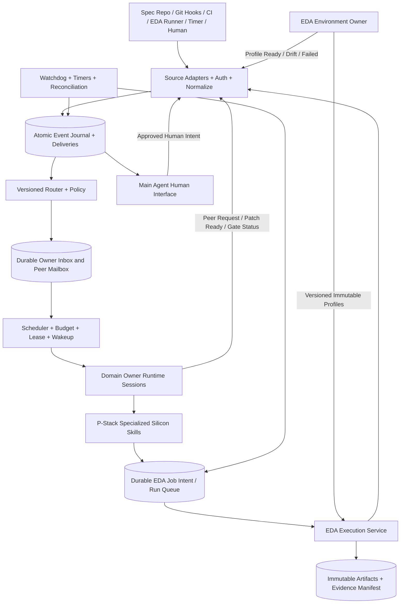
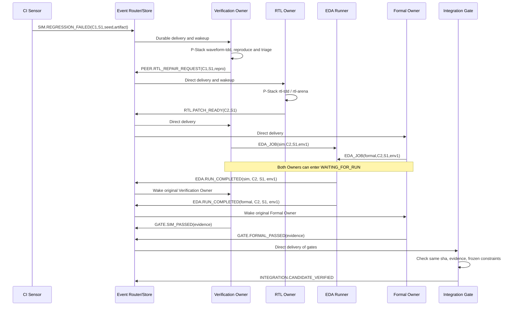

# SiliconForge v2.2：Super Agent 自主執行、Agent Communication、EDA Observability 與 PDCA 架構規格書

**文件性質**：可落地的架構規格、介面契約與 A0 至 A5 驗收計畫。  
**日期**：2026-11-07。  
**狀態**：Architecture RFC，部分政策採建議預設值，待使用者調整。  
**適用範圍**：完整繼承 v2.1 的 Runtime、事件調度、工作恢復、模型選擇及環境治理設計；新增協作協定、五層觀測資料、Dashboard Read Model 與 PDCA。沿用 v2.0 的 APB CRC32 IP 和專業化 P-Stack Skills。  
**原型狀態**：隨附 A0 Python/SQLite Reference Kernel 加上 v2.2 Observability Reference，共 19 項模擬／架構測試通過。尚未實現真實 Harness、EDA、正式 Peer Request 狀態機或生產級 Telemetry；不可當作真正晶片工程驗收。

## v2.2 版修訂導讀

v2.2 不變更 Super Agent Runtime 與 Domain Owner 的決策權分工。新增第 12 章 Agent Communication、第 13 章 Observability、第 14 章 PDCA；既有 A0 Reference Kernel、驗收、Repository、Coding Agent 指令與其他章節順延至第 15 至 20 章。正式實作必須把通訊紀錄、Agent 執行紀錄、EDA 產物與工程決策透過共同識別碼串起來，支援閉環自動恢復、歷史查詢、Dashboard 與有驗證證據的流程改版。

## 0. 設計裁決與唯一目標

建立能長期自主運作的晶片工程 Super Agent Runtime。外部或內部事件驅動領域 Owner 執行工程工作，Owner 以自己的 P-Stack Silicon Skills 做實際判斷；每個 EDA 工具工作由受控 Runner 執行，工具結果再次變成事件，喚醒原 Owner 或其他 Owner，形成可持續閉環。人類 Main Agent 只負責互動與協調，不是所有事件的流程控制器。

### 0.1 兩層與一個專屬環境 Owner

| Layer | 掌握的事情 | 不允許做的事情 |
|---|---|---|
| Super Agent Runtime | Source 接收、去重、授權、持久化、Routing、喚醒、排程、超時、恢復、Budget、Event Loop、稽核 | 分析 RTL Bug、決定微架構、選測試漏洞修法、以模型判定 EDA PASS |
| Domain Owner 內的 P-Stack 專業化 | 專業規劃、Skill 選擇、Subworker 分工、EDA 工作提交、工具證據分析、Peer Request、局部迭代與結案 | 自行建立全域事件匯流排、繞過品質 Gate、改寫正式工具版本、無授權修改跨領域資產 |
| EDA Environment Owner | Toolchain Baseline、版本鎖、容器、依賴、PDK／Library、工具相容性、環境健康、升級、回滾 | 代替 Formal／RTL／Verification Owner 決定功能正確性，或介入每一個健康的 EDA Job |
| EDA Execution Service | 啟動與監督工具進程、擷取 exit status、產出 artifact、解析標準證據、發布工具事件 | 用自然語言代替工具實跑、修改規格與測試以求通過 |
| Main Agent | 人類對話、意圖收集、查詢任務、彙報阻礙、傳遞人類授權 | 擔任中央工程仲裁者、代選微架構、偷偷調整硬性約束 |
| Process Improvement Owner | 從版本化 Telemetry、成功與失敗案例建立 PDCA 提案、執行隔離實驗與效果分析 | 逕改 live Routing、篡改 Evidence Gate、直接裁決 RTL 或環境版本 |
| Observability Projector | 將權威事件轉成唯讀狀態、Trace、Metrics、Dashboard、查詢 API | 控制 Domain Owner 或作為 Event Journal 的唯一保存處 |

**主體自治性的邊界**：Runtime 對任務生命週期與工具權限擁有政策權；Owner 對授權範圍內的專業決策擁有權。跨 Owner 工作要求以 Event 發送，而非由 Runtime 指揮每個工程步驟。

### 0.2 與參考專案的明確差異

DeepSeek dsh-superagent-prototype 的 Trigger、Ticket、Assignment、Mandate、Executor、復原及 Source/Thread 概念值得沿用，但其 Main Session/Eval 在許多工作接入時扮演主要評估者。SiliconForge 不繼承這個中央 LLM Gate，常規工程事件由已核准的規則直接 Routing。P-Stack 的 Parent 工程權威與品質技能則只存在於每個 Domain Owner 的內部；可將 Poteto Mode、Arena、Swarm、Interrogate、Reflect 等思維適配成 Silicon Skills。Cadence ChipStack 只作為目標能力的工程參考，不假設擁有其私有實作或確切內部事件協定。

參考來源：
* https://github.com/deepseek-ai/dsh-superagent-prototype/blob/main/docs/001-domain.md
* https://github.com/deepseek-ai/dsh-superagent-prototype/blob/main/docs/002-authorization.md
* https://github.com/deepseek-ai/dsh-superagent-prototype/blob/main/docs/003-execution.md
* https://github.com/deepseek-ai/dsh-superagent-prototype/blob/main/docs/007-architecture.md
* https://github.com/Aqua-123/pstack-for-codex
* https://github.com/cursor/plugins/blob/main/pstack/docs/guide/04-design.md
* https://community.cadence.com/cadence_blogs_8/b/artificial-intelligence/posts/meet-cadence-s-chipstack-ai-super-agent

## 1. Runtime Components，實際由誰接收、誰執行、誰喚醒



**不允許的捷徑**：`Sensor -> Main LLM -> decide -> run script`、`Owner -> shell install random EDA -> assert pass`、`tool stdout -> LLM says done -> integration`。

### 1.1 A0 Runtime Services

1. **Ingress**：Webhook、Git polling、filesystem watcher、CI callback、EDA completion callback、timer 的來源連接。收到資料時先驗證真實來源，不直接信任 payload 自稱的 producer。
2. **EventNormalizer**：轉成版本化 EventEnvelope；固定來源 revision、canonical payload hash、event_id、correlation 及 evidence references。
3. **EventStore**：將接收事件及各 Owner 的 Delivery 在同個 transaction commit；任何 Process crash 之後事件仍可回放。
4. **DeterministicRouter**：比對 project、block、event_type、scope、current policy，建立 primary 與 subscriber deliveries；第一版沒有路由 LLM。
5. **Scheduler**：從 Owner Inbox 選可執行的 Delivery，檢查 budget、資源、等待條件、鎖、優先權與背壓。
6. **OwnerSessionSupervisor**：建立或恢復 Owner Session。Owner 長期擁有 DomainTicket，但只有有待處理事件才需要消耗 LLM Token。
7. **JobDispatcher**：將 Owner 的 EDA Job Intent 原子持久化後，再交 Runner 執行；Runner 有唯一 fingerprint 及可復原狀態。
8. **Watchdog/Timer**：監控心跳、租約、工具狀態、超時；發佈 SYSTEM 與 TIMER 事件，而不是直接讓 Main Agent 頻繁追問 Worker。
9. **EvidenceGate**：解析與檢查 signed/attested 工具結果、相同 design/spec/environment fingerprint，以及正式 Exit Predicate。
10. **NotificationRelay**：面向人類、儀表板與 Main Agent 的唯讀彙整，以及審核決策回注，不參與工程結論。

### 1.2 為什麼不是一個永遠不停呼叫模型的 Main Agent

Owner 正在等待模擬時，持久狀態留在 Database，LLM Session 可以被釋放；新的 EDA 完成事件自動重新喚醒 Domain Owner。這讓持續自治依賴穩健的 Runtime，而不是模型必須 24 小時保持推理會話。Runtime 持續在線，Owner Session 按事件喚醒，Worker／工具在需要時並行運作。

## 2. 事件生命週期協定，從 External Trigger 到下一次自動 Wakeup

定義完整路徑 `Ingress -> Authentication -> Normalize -> Durable Commit -> Route -> Owner Inbox -> Scheduler -> Owner Wakeup -> DomainDecision -> Tool/Peer Request -> Tool Callback -> Ingress`。

### 2.1 最小事件封包與必要欄位

```json
{
  "schema_version":"2.1",
  "event_id":"evt_0128",
  "event_type":"EDA.RUN_COMPLETED",
  "producer_principal":"service:eda_runner",
  "source_id":"runner-01",
  "source_revision":"job-009:attempt-2",
  "project_id":"apb_crc32_demo",
  "block_id":"apb_crc32",
  "trace_id":"trace_0005",
  "causation_id":"evt_0091",
  "correlation_id":"ticket_verif_004",
  "idempotency_key":"job-009:success:attempt-2",
  "routing_policy_version":"routes-1",
  "mandate_id":"m_apb_crc32_sandbox",
  "spec_sha":"sha256:spec1",
  "candidate_sha":"git:candidate2",
  "toolchain_profile":"eda_crc32_v1",
  "environment_digest":"sha256:env1",
  "artifact_refs":["cas://sha256/<report-digest>"],
  "payload":{
    "job_id":"job-009",
    "requesting_owner":"verification",
    "exit_code":0,
    "normalized_result":"SIM_PASS",
    "evidence_kind":"REAL_EDA"
  }
}
```

**不可省略的精確語意**：`event_id` 只代表一次持久事件，`idempotency_key` 代表來源中的同一個事實，`trace_id` 代表長期目標，`correlation_id` 對應一個 Peer Request 或 Domain Ticket，`causation_id` 指向引發這次事件的上一個事件；`spec_sha` 和 `candidate_sha` 必須出現在與工程證據相關的事件。Toolchain digest 是環境身份，不是寬鬆的版本說明。

### 2.2 Ingress transaction

1. 驗證來源：可信 CI 只能發 Simulation/CI 類事件，EDA Runner 只能發對應既有 Job 的工具結果，Environment Owner 只能發環境事件，Human Gateway 只發經核准的人類決策。
2. 驗證 Schema 和 Source Revision，核對 artifacts 存在且校驗成功。
3. 計算 `source_id + source_revision + canonical_payload_hash + event_type` 的去重鍵。相同事實只產生一個 logical Event。
4. 在同一資料庫交易中插入 Event Journal 與每個 Owner Delivery，並寫入 dispatch intent；commit 後由 Scheduler 讀取。
5. 若事後發現原有事件處理失敗，重新投遞其既有 Delivery，不發明新 Event；不允許以重送 webhooks 產生無限工作單。
6. 無授權或無法分類事件進 Quarantine，記錄原始封包摘要與原因，不自動讓 Main Agent 重新判定成允許工作。

**配送保證**：至少一次（at-least-once）投遞。下游依事件 ID、Job fingerprint、DomainTicket revision 去重，達成在業務意義上的單次有效進展。不要聲稱跨 LLM、Process、EDA 工具具有真正的 end-to-end exactly-once。

### 2.3 Durable Delivery 與 Worker Lease

每次直接投遞建立 `delivery(event_id, target_owner, state, attempt, available_at, lease_until, fencing_token)`，狀態為 `READY -> CLAIMED -> ACKED`，超時轉為 `RETRY_WAIT` 再回 `READY`，超過重試上限進 `DEAD_LETTER`。

Scheduler 每次發派發 `fencing_token`；任何過期 worker 的結果不得覆寫後來有效 worker 的 Ticket state。Owner 必須以 optimistic concurrency（Ticket revision）寫入新狀態。模型、Shell 和 EDA 工具運作時不得持有 SQLite 交易鎖。對外的 Job Submission 先寫 durable Outbox；由另外的 Adapter 執行，完成後入站新的事件。

### 2.4 喚醒與免輪詢設計

Owner Supervisor 以事件通知（本機 queue/condition 或將來 NATS）喚醒 Inbox；即使通知遺失，Watchdog 也定期掃描未 ACK 的 durable inbox。第一版可採 10 秒掃描的預設值，之後根據性能調整。

EDA Job 不依賴 LLM 自己呼叫 sleep 或無限 polling：`RUNNER.JOB_STARTED` 更新監控；Process exit/monitor 收到完成，Runner 發 `EDA.RUN_COMPLETED`；Owner 收到新事件後恢復 checkpoint。Tool 超時發 `EDA.RUN_TIMEOUT`，Owner 或 Environment Owner 視錯誤歸屬採取處理。

### 2.5 自主閉環的唯一合法結束條件

`DomainTicket` 不是在 LLM 回答「已完成」時就關閉。正常閉環以 `Exit Predicate` 成立、所有 Gate 的證據綁在同一個 frozen design/spec/toolchain fingerprint、Integration fresh-run 通過後結束。其他合法終態是 `BLOCKED_WITH_EVIDENCE`、`CANCELLED_BY_POLICY`、`SUPERSEDED`。任何未回收依賴或未知工具結果不得等同於完成。

## 3. 事件 Routing 規則，直接找到正確的 Owner

| Event Pattern | Producer | Direct Primary Owner | 自動動作 | 其他方向 |
|---|---|---|---|---|
| `SPEC.APPROVED_CHANGED` | approved_spec_source | Spec | 影響分析、更新 contract、產生 per-domain requests | RTL / Verification / Formal 訂閱 contract changed |
| `RTL.PATCH_READY` | RTL | Verification | 開始 Simulation；同時可投 Formal | Formal 直接收獨立 Delivery |
| `SIM.REGRESSION_FAILED` | trusted_ci / runner | Verification | Waveform TDD、Bug 分類 | 根因為 RTL 才發 `PEER.RTL_REPAIR_REQUEST` |
| `PEER.RTL_REPAIR_REQUEST` | Verification | RTL | 修補、Arena、局部測試、產生新 Candidate | 直接回傳 Verification |
| `FORMAL.PROOF_FAILED` | runner | Formal | Counterexample triage | 必要時請求 RTL／Spec |
| `PPA.TARGET_CHANGED` | approved_target_source | PPA | baseline、constraint comparison、優化策略 | 涉及微架構才請求 RTL |
| `EDA.RUN_COMPLETED` | EDA Runner | 原 Job requesting_owner | 分析工具結果、選下一步 | 不送 Main 轉派 |
| `EDA.RUN_TIMEOUT` | EDA Runner | 原 Job requesting_owner | 區分設計難度／infra 故障 | Infra 類另發 `PEER.ENV_DIAGNOSE_REQUEST` |
| `ENV.PROFILE_REQUIRED` | Runtime | EDA Environment | 準備環境 baseline、相容性測試 | 不需要通知全部 Owner |
| `ENV.PROFILE_READY` | EDA Environment | Runtime unblock + 訂閱者 | 相同 digest 的 blocked jobs 自動重新排隊 | 觸發尚未完成的 Owner 工作 |
| `ENV.PROFILE_DRIFT` | Monitor | EDA Environment | 隔離失效 profile、修復或回滾 | Runner 暫停不可信 profile 的新 Job |
| `GATE.*_PASSED` | 對應領域 Owner + 工具證據 | Integration | 查同一 revision 的全套 Gate | 只產生客觀整合決策 |
| `HUMAN.INTENT_SUBMITTED` | Human Gateway | Spec 或明確領域 | 在既有 mandate 內解讀為 scope change | Main 可協助結構化，但非必經 |
| `HUMAN.APPROVAL_GRANTED` | authenticated approval service | 等待的人員授權 Request Owner | 檢查 policy_version、mandate、revision，恢復 Ticket | Main 只負責詢問與轉達 |
| `TIMER.RETRY_DUE` | Watchdog | Ticket 原 Owner | 重新喚醒、按 retry policy 恢復 | 不產生全域總管工作 |
| `TOOLCHAIN.UPDATE_PROPOSED` | EDA Environment | EDA Environment | staging build、regression、相容性審查 | promotion 規則決定是否請人類 |

**單一 Primary 的意思**是每個事件有一個責任 Owner，但 fanout 事件可有多個彼此獨立的 Delivery。例如 RTL Patch Ready 可直接投 Verification 和 Formal：各自有工作與結果，並非 Formal 被 Verification 的 LLM 指揮。

### 3.1 Route Conflict Handling

同類事件若 project/block 有不同路由，以 longest-specific-match 加明確 `priority` 選取。相同 priority 且同程度具體、卻指向不同 Owner，設定檔驗證失敗而不能啟動服務。Unknown event 不送 Main 作通用推理。變更 Routing 必須 versioned rollout，已在途 Delivery 保留當初 policy version，必要時做明確 migration/requeue。

### 3.2 可以直接實作的路由規格

```yaml
route_version: 1
rules:
  - id: sim-regression-failed
    priority: 100
    match: {type: SIM.REGRESSION_FAILED, project: '*', block: '*'}
    primary_owner: verification
    deliver_to: [verification]
    require_principal: [service:trusted_ci, service:eda_runner]
    delivery: durable_at_least_once
    dedupe_scope: source_revision_and_payload
  - id: rtl-patch-ready
    priority: 100
    match: {type: RTL.PATCH_READY, project: '*', block: '*'}
    primary_owner: verification
    deliver_to: [verification, formal]
    require_principal: [owner:rtl]
  - id: eda-run-completed
    priority: 100
    match: {type: EDA.RUN_COMPLETED, project: '*', block: '*'}
    primary_owner_from: lookup_existing_job.requesting_owner
    require_principal: [service:eda_runner]
  - id: environment-required
    priority: 100
    match: {type: ENV.PROFILE_REQUIRED, project: '*', block: '*'}
    primary_owner: eda_environment
    require_principal: [service:runtime]
```

注意 `requesting_owner` 必須根據已存在的 Job Registry 查出，而不是信任 callback payload 直接指定，否則偽造訊息可能任意喚醒其他 Owner。A0 原型以 payload owner 展示路由概念，正式版需替換為 Job Registry lookup 和來源鑑別。

## 4. Domain Ticket、Run 與 Agent Session 完整狀態機

### 4.1 Ticket（工程工作持久狀態）

```text
ADMITTED -> ANALYZING -> EXECUTING -> EVALUATING -> CLOSED_VERIFIED
                 |            |           |
                 |            |           +--> REVISING --> EXECUTING
                 |            +--> WAITING_FOR_RUN --> READY_TO_RESUME
                 |            +--> WAITING_FOR_PEER --> READY_TO_RESUME
                 |            +--> WAITING_FOR_ENV --> READY_TO_RESUME
                 |            +--> NEEDS_HUMAN --> READY_TO_RESUME
                 +--> BLOCKED_WITH_EVIDENCE / SUPERSEDED / CANCELLED
```

真正的 DomainTicket 至少保存 `id, owner, project, block, trace, goal, mandate, policy_version, state, checkpoint_ref, inbox_cursor, spec_sha, candidate_sha, profile_digest, dependency_ids, last_processed_event, attempt_budget, spending, last_result, next_action, revision`。

Session 是執行媒介，不等於 Ticket。Session 可以停用、重開、切換 Harness；Ticket 與 Context checkpoint 必須獨立持久存在。

### 4.2 EDA Job 與 Runner

```text
SUBMITTED -> WAITING_FOR_ENV -> QUEUED -> LEASED -> RUNNING -> UPLOADING_EVIDENCE
                                                   |                    |
                                                   |                    +--> COMPLETED_PASS / COMPLETED_FAIL
                                                   +--> TIMEOUT / INFRA_ERROR / CANCELLED
```

`COMPLETED_PASS` 代表 Runner 驗證執行完成且符合該工具的機器條件，不代表整個設計通過所有 Gate。Runner 發事件前，必須保存 tool exit status、parser result、log/coverage/waveform references、toolchain digest、script hash、input hash 與 sandbox ID。

### 4.3 Peer Request 等待策略

Owner A 發 `PEER.REQUEST` 時建立 `awaits=[request_id, expected_event_type]` 並寫入 checkpoint。Owner B 若需要其他證據，回 `PEER.NEEDS_EVIDENCE`，A 不經 Main 直接補件。B 若回傳 `PEER.RESULT_READY`，對照 request ID、spec SHA、result schema 後 A 被 Scheduler 喚醒繼續。超時由 Timer 發 `PEER.TIMEOUT` 送回 A，A 可以重試、採備援方案或形成 Blocker。

## 5. 詳細 Sequence：Simulation Failure 如何繞回 RTL，再繞回驗證



若 Simulation 再度失敗，Verification Owner 自行產生新的 `PEER.RTL_REPAIR_REQUEST`，`attempt_no` 增加且 `candidate_sha` 或 failure evidence 必須有實質變化。不能因為同一個失敗資料又被讀取而無限修復。三次相同失敗而無新的可行方向時，Domain Owner 應進入 `BLOCKED_WITH_EVIDENCE` 或切換已授權的策略，不應無限輪詢 Main。

### 5.1 Event Loop 如何避免死循環

設計三個不同的 ID：`event_id` 去除相同 Source 事件、`action_fingerprint` 避免相同 Owner 對相同 Evidence 發出重複命令、`job_fingerprint` 避免相同工具輸入產生重複 Run。相同 candidate/spec/env 的工具結果不需要重跑，除非 retry policy 要求 fresh-run，這時使用不同的 `run_generation`。對實際設計改變的新候選，應當形成新的 fingerprint，合法迭代不會被去重錯殺。

`trace_id` 可持續跨多個候選；任何 Owner 的最大迭代數、時間、CPU、Token 由 Budget Governor 監督。超出預算要明確阻擋或向人類申請新額度，不能偷換模型或自動開更昂貴方案繞過限制。

## 6. EDA Environment Owner：專用維運 Agent 的權限與完整程序

### 6.1 職責與邊界

負責：toolchain baseline 版本選型；Verilator/cocotb、Yosys/SymbiYosys/Solver、OpenROAD Flow Scripts、SystemC、PDK、standard cell library 的映像建置；dependency lock；工具相容性矩陣；preflight smoke；run-to-run 版本一致；相依環境故障分析；版本更新與 rollback；CPU/RAM/license 容量報告；工具來源與許可條款。

不負責：規格修正、RTL 重構、Testbench 作弊式修改、Formal Property 弱化、選 PPA 微架構優勝者。其他 Owner 只能讀取 Registry 的 approved profile 和要求 Runner 使用已批准的 profile；不能私自升級或另裝 EDA，以免產生跨工具版本不可比較性。

### 6.2 Toolchain Profile Manifest v1

```yaml
profile_id: open_eda_crc32_v1
status: APPROVED
image:
  name: siliconforge/eda-open
  digest: sha256:FIXED_CONTAINER_DIGEST
platform:
  os: linux
  architecture: x86_64
  cpu_cap: 8
  memory_gb: 16
sources:
  verilator: {git_commit: PINNED_SHA}
  cocotb: {package_version: PINNED_VERSION}
  yosys: {git_commit: PINNED_SHA}
  symbiyosys: {git_commit: PINNED_SHA}
  formal_solver: {name: boolector, build: PINNED_SHA}
  openroad_flow_scripts: {git_commit: PINNED_SHA}
  systemc: {version: PINNED_VERSION}
pdk:
  name: nangate45
  library_digest: sha256:LIBRARY_DIGEST
  sdc_profile_digest: sha256:SDC_DIGEST
preflight:
  required: [tool_version_check, rtl_compile_smoke, sim_smoke, formal_smoke, yosys_smoke, openroad_smoke]
provenance:
  built_by: eda_environment
  approved_at: null
```

這份 Manifest 是格式示例，`PINNED_SHA` 等占位符必須在 Environment Owner 實際安裝後填入真實且可解析版本，不能當作已鎖定環境。執行階段應使用映像 digest 與 PDK digest，而不是會漂移的 `latest` image tag。

### 6.3 Environment 生命周期

```text
PROFILE_REQUESTED -> STAGING_BUILD -> PREFLIGHT -> COMPATIBILITY_TEST
       -> READY_FOR_PROMOTION -> APPROVED / REJECTED
APPROVED -> ACTIVE -> DRIFT_DETECTED -> QUARANTINED -> REPAIR / ROLLBACK
```

1. `ENV.PROFILE_REQUIRED` 時，Environment Owner 檢查 Registry；已經 Approved/Healthy/相同 Digest，直接回傳 ready reference。
2. 若缺失，在專用 staging sandbox 建置。下載、安裝與更新由 Environment Owner 依授權資源限制執行；其他 Owner 不得改動全域環境。
3. 完成 `preflight` 後，產生 Compatibility Report 與 image digest；允許對測試 profile 自動 promotion 的政策可設定，正式 shared profile 的變更預設需 human authorization。
4. 發布 `ENV.PROFILE_READY(profile,digest)`，Runtime 自動將 `WAITING_FOR_ENV`、且要求同一 digest 的 Job 重新排入隊列。
5. 發生版本漂移、Runner ABI mismatch、PDK 缺檔或不可復現時，由 Runtime 阻擋該 profile 的新 Job，直接發 `ENV.PROFILE_DRIFT` 給 Environment Owner。
6. 如果只是個別工具 Job OOM，Runner 發失敗；Environment Owner 判斷 RAM 配額或環境資源不足，不任意升級 Toolchain 版本；如需擴充資源，走 Resource Governor。
7. Formal / Simulation / PPA 結果必須標 `environment_digest`。不同 digest 的數據不能直接混合比較；如需跨版本比較，必須重新執行可比性基線。

### 6.4 不要讓 Environment Owner 成為每個 Run 的瓶頸

Runner 每次執行只需要向 **Toolchain Registry（服務）** 驗證已批准、健康、不可變的 digest。日常沒有 Environment Agent 推理消耗。只有 profile 缺失、健康檢查失敗、更新、升級、資源故障時，才使用 EDA Environment Owner 的模型判斷和 P-Stack Skills。

### 6.5 Environment Owner 的特化 P-Stack Skills

| 基底 | 專用 Skill | 觸發 | Exit Predicate |
|---|---|---|---|
| `architect` | `eda-profile-architect` | 新 toolchain 基線 | 完整 lock、相依圖、明確 profile 行為 |
| `swarm` | `eda-compatibility-swarm` | 建置或升級 profile | Sim/Formal/Synthesis/PPA smoke 均有真實記錄 |
| `interrogate` | `eda-upgrade-interrogate` | 新版工具與 PDK 上線 | 舊／新環境可比較性、回退策略、license 風險已審查 |
| `tdd` | `eda-failure-reproducer` | Tool crash / mismatched ABI | 能重現原故障、可驗證修復 |
| `reflect` | `eda-incident-reflect` | 已確認環境事故 | 新增 preflight／policy test，防相同事故再現 |

## 7. P-Stack 應嵌在 Owner 內，不是全域流程控制器

| Domain Owner | P-Stack 專業 Skill 組合 | 具體輸入 | 可產出的下一個 Event |
|---|---|---|---|
| Spec | `silicon-architect`, `design-impact`, `design-interrogate` | requirement revision、architecture constraints、history | `CONTRACT.CHANGED`、`PEER.SPEC_CLARIFICATION_RESULT` |
| RTL | `rtl-tdd`, `rtl-arena`, `design-interrogate`, `engineering-evidence` | frozen contract、repro、timing request | `RTL.PATCH_READY`、`RTL.OPT_CANDIDATE_READY` |
| Verification | `waveform-tdd`, `verification-swarm`, `coverage-closure` | VCD、test seed、oracle、coverage | `PEER.RTL_REPAIR_REQUEST`、`GATE.SIM_PASSED` |
| Formal | `property-architect`, `formal-proof-swarm`, `formal-triage` | approved properties、assumptions、counterexample | `PEER.RTL_REPAIR_REQUEST`、`GATE.FORMAL_PASSED` |
| PPA | `ppa-arena`, `ppa-benchmark-audit`, `timing-closure` | fixed SDC、lib、platform、QoR reports | `PEER.RTL_OPTIMIZATION_REQUEST`、`GATE.PPA_PASSED` |
| Integration | `integration-proof`, `engineering-evidence` | every gate manifest, same source snapshot | `INTEGRATION.CANDIDATE_VERIFIED` |
| EDA Environment | `eda-profile-architect`, `eda-compatibility-swarm`, `eda-failure-reproducer` | toolchain profile、health reports | `ENV.PROFILE_READY`、`ENV.PROFILE_QUARANTINED` |

各 Owner 用 P-Stack 的局部 Parent 模式：Owner 自己決定要採 `arena` 還是 `swarm`，讓 Worker 平行執行；對本領域 candidate 應用独立的 review/cross-judge，之後把結果交給機器 Gate。可執行的一般規則：

1. **給工程證據的 Skill 是必需品**，所有結案必須有 Machine-readable Evidence。
2. **Parallel Workers** 必須在不同 worktree 或不同唯讀資料加獨立輸出目錄，不能共享一個可寫 RTL repo。
3. **Domain Skill 本身不可升權**。例如 `rtl-arena` 的 Worker 即使發現 test 有問題，也不能直接修改 golden oracle。
4. **整合者就是該 Domain Owner**，不是 Main Agent，且不能越權批准其他 Owner 的 Gate。
5. **模型選擇由 Owner Role Policy 管理**，不是某個 Skill 臨時找可用最貴模型就切換。
6. **失敗回饋** 必須重新進 Domain Ticket，要求新 evidence 或合法更改候選，不能只在對話層回答已分析。

## 8. Harness 與 Model Selection，先用穩定配置而不是把決策散落 Prompt

### 8.1 v2.1 建議的模型／Harness 起點

**第一階段：Codex CLI 為所有工程 Domain Owner 的預設 Harness；P-Stack for Codex 作為 Skill adapter。** 這是可驗收的統一基線，避免同時整合多 Harness 造成狀態、工具權限、成本與復原語義不一致。Claude Code 可保留介面但先不列為 A0 的完成條件。

**需要把業務狀態與 Harness Session 解耦**：`DomainTicket`、所有 Event、Checkpoint、Artifact refs、Skill Plan、Constraints、工具結果必須保存在 Runtime Store。任何 CLI Session 只能是執行載體。未來引入 Claude Code、OpenAI API 或本機模型時，用同樣 `OwnerSessionAdapter` 合約。

```python
class OwnerSessionAdapter:
    def start(self, owner_id, ticket_id, checkpoint_ref, mandate, model_route): ...
    def resume(self, owner_id, ticket_id, checkpoint_ref, inbox_events): ...
    def cancel(self, run_id, reason): ...
    def checkpoint(self, run_id): ...
    def capabilities(self): ...
```

Adapter 輸出必須是結構化 `DecisionPlan`：`reason_summary`, `skill_name`, `job_intents`, `peer_events`, `new_ticket_state`, `checkpoint_ref`, `budget_consumption`, `evidence_refs`。不能直接接受任意 LLM 文字做工具授權；Job Intent 仍經 Runtime schema / Policy / Resource Governor 驗證。

### 8.2 Model Routing Policy（預設值）

```yaml
model_policy_version: 1
default_harness: codex_cli
roles:
  spec:            {tier: reasoning, effort: high}
  rtl:             {tier: coding, effort: medium}
  verification:    {tier: coding, effort: medium}
  formal:          {tier: reasoning, effort: high}
  ppa:             {tier: reasoning, effort: medium}
  integration:     {tier: compact, effort: low}
  eda_environment: {tier: coding, effort: medium}
  main:            {tier: compact, effort: low}
escalation:
  - when: repeated_verified_failure
    action: high_reasoning_tier_after_budget_check
  - when: cross_domain_requirement_conflict
    action: ask_authorized_human
fallback:
  on_rate_limit: wait_or_approved_lower_tier
  on_context_exhausted: checkpoint_then_new_session
  require_capability_check: true
  never_auto_override_approved_models: true
```

此處的 `tier` 是抽象能力分類，不代表任何供應商都有這些精確名稱。實際模型 ID、effort 支援、登入方式與服務限制，必須由 Harness Adapter 執行期檢查並生成 `model_routes.lock`。若模型不可用，保留 Ticket 並觸發合法的 fallback 或 `MODEL_CAPACITY_BLOCKED`。**不允許因模型不可用就換成另一個未知成本和權限的模型**。

### 8.3 切換位置與回復可行性

只在安全 checkpoint／Skill 子任務邊界切換模型。原子化工具工作仍由原 Job/Runner 繼續，不因模型切換重跑。新 Session 須讀取 frozen input SHA、last_event、已提交的 Peer Request、已完成 Evidence 及下一步。不得靠舊 Session 的隱含對話記憶才能恢復。

## 9. 人類介入、政策與不打擾原則

將人類介入分成三類：

| 分類 | 事件條件 | Runtime/Owner 行為 | 人類介入 |
|---|---|---|---|
| A，自動 | 已批准 spec 內的 RTL patch、增加 regression、Formal 分析、固定約束下的 PPA search、既有 Toolchain 重跑 | 自主執行，達條件自動交接與驗收 | 無需逐次確認 |
| B，需要限定授權 | 修改已批准 Requirement／安全假設、放寬硬性 PPA gate、增加超過預算的昂貴模型或計算、變更 production Toolchain/PDK baseline | 記錄選項、影響和 Evidence，轉 `NEEDS_HUMAN`；其他不受影響工作繼續 | 由 Main 呈現人類選擇，經 Approval Gateway 回注 |
| C，禁止自動 | 對外公開 IP／提交未知遠端、使用未批准 Secrets、推送受保護分支、產品簽核／Tapeout、隱藏或刪除 Gate Evidence | 擋在 Policy Gate，無法自行轉成允許 | 不因任何 Agent 自行判斷而放行 |

**Approval Contract**：`approval_id`, `requesting_ticket`, `scope`, `requested_change`, `decision_options`, `evidence`, `actor_identity`, `approved_revision`, `expiration`, `policy_version`。收到授權時必須檢查 request 是否仍與當前 spec/candidate 相同。過期批准不可套到新的要求。

例如 `NEEDS_HUMAN` 的最小呈現：`S1 要求 2-cycle latency，PPA Owner 建議 pipeline 4-cycle 以達 timing，這需要改 approved performance requirement；方案 A 保持 S1 並 BLOCK，方案 B 修改 latency 上限並重新驗證，附各自預估成本及證據`。Main 只轉達和紀錄，不自己選 B。

## 10. EDA Runner 實作契約與 Evidence Gate

### 10.1 EDA Job Intent

```json
{
  "job_id":"job-0012",
  "requesting_owner":"verification",
  "ticket_id":"ticket-023",
  "tool_adapter":"verilator_cocotb",
  "toolchain_profile":"open_eda_crc32_v1",
  "environment_digest":"sha256:KNOWN_IMAGE",
  "spec_sha":"sha256:S1",
  "candidate_sha":"git:C2",
  "test_suite":"regression-apb-crc32",
  "seed":17,
  "timeout_seconds":600,
  "cpu_limit":4,
  "memory_gb":8,
  "allowed_inputs":["cas://sha256/INPUT_BUNDLE"],
  "expected_output_schema":"sim-evidence-v1",
  "idempotency_key":"sha256:JOB_FINGERPRINT"
}
```

EDA Runner 不由模型決定任意 executable path。Job `tool_adapter` 必須對照 Approved Tool Registry，再在隔離 sandbox 中執行固定 executable/allowlisted script。正式環境鎖住網路、檔案可寫路徑、Secrets、CPU/RAM/time limits。Inputs 預設唯讀，Outputs 寫獨立 CAS。

### 10.2 Evidence Parser 結果分類

1. `SIM_PASS` / `SIM_FAIL`：必須有實際 test suite、seed、tool exit 和可查閱結果。Nonzero return code 與 Fail report 的組合不能被模型改說 PASS。
2. `FORMAL_PROVEN` / `FORMAL_COUNTEREXAMPLE` / `FORMAL_UNKNOWN`：unknown、timeout 不能視為 proved。
3. `SYNTH_SUCCEEDED`：產出 netlist、統計與適用 tool config；不代表後端 Timing Closure。
4. `PPA_METRIC_VALID`：在同 platform、lib、SDC、corner、stage 比較。Power 必須有有效 activity / methodology，不得以無憑據數字當 signoff。
5. `INFRA_ERROR`：工具未啟動、版本／ABI mismatch、容器缺失、檔案損毀，導向 Environment Owner。
6. `NOT_VERIFIED`：證據不全、SHA 不一致、只執行 fake tool、模型自稱成功等情形。

### 10.3 Integration Gate

`approved_spec_sha == candidate.spec_sha && all_required_gates_pass && required_artifacts_present && evidence_kind == REAL_EDA && same_candidate_sha && same_environment_digest && same_constraints_fingerprint && no_unresolved_hard_blocker && mandate_allows_candidate_integration`。

**Mock 執行永遠只能得到 `MOCK_COMPLETE`，不能得到 `INTEGRATION.CANDIDATE_VERIFIED`**。正式 Signoff 另需人類批准，不得被 Integration 的 Agent 自行替代。

## 11. Retry、Timeout、Dead Letter、模型與 Agent Crash Recovery

### 11.1 失敗分類及策略

| 故障 | 應由誰處理 | 首輪預設行為 |
|---|---|---|
| Runner process crash / OOM | EDA Environment + 原 Owner | 保留證據、環境檢查、有限次重試，不變更功能規格 |
| Tool formal timeout | Formal Owner | 分析 solver 假設與分區，合法探索後若仍 unknown 則 BLOCK |
| Simulation functional fail | Verification Owner | Repro、waveform root cause，按證據發 Peer RTL repair |
| PPA 不達標 | PPA Owner | 同限制內 search；涉及 RTL 由 Peer Request 發往 RTL |
| Owner process crash | Supervisor/Watchdog | lease expire、checkpoint resume、同一 Ticket、同一事件去重 |
| Harness API rate limit | Runtime Scheduler | checkpoint、退避、已批准模型 fallback，不要求 Main 決策 |
| Peer 無回覆 | 原 Request Owner | retry/timeout event，保留 correlation，不新增無限工作單 |
| Toolchain profile drift | EDA Environment | quarantine profile、rollback/repair、阻擋不可信 run |
| 批准需求互相矛盾 | Spec Owner | 產出具體 conflict request，請人類做需求選擇 |

### 11.2 重啟恢復演算法

1. Runtime 重啟：掃描 `READY`、`RETRY_WAIT` 和過期 `CLAIMED` Deliveries；按照 fencing token 防止舊 worker 回寫。
2. 檢查所有 `RUNNING` Job 的獨立 Runner 進程，能 reconnect 則繼續監控；無法 reconnect 則標 `UNKNOWN_ORPHANED`，確認沒有副作用後重試。
3. Owner Session 若已不存在，從 `DomainTicket.checkpoint_ref` 與 Event Journal 重建上下文，再取得下一次 Inbox Delivery。
4. 每一個新的工具工作先檢查 job fingerprint，必要時 attach 到既有 Run，而不是重建候選或重跑大規模 PPA。
5. 不因 Main Agent 是否在線而停止任何已授權工作。
6. 未知狀態不能直接回報 PASS；產生可診斷 Blocked 狀態或補足可重放的 Run。

### 11.3 成本與自主安全界線

Budget Governor 管控模型請求 Token、CPU hours、memory、worker parallelism、EDA licenses、每次 Arena 最大候選數與每條 WorkItem 累積限額。初期範例：RTL Repair 每個 Root Cause 最多 3 次、Arena 最多 3 個候選、Owner 同時最多 2 個 writer worktree。這些是可調預設值，不應混入 Prompt 成為固定不可調魔法數字。

## 12. Agent Communication Protocol：面向工程意圖的可追溯通訊

### 12.1 通訊設計裁決

SiliconForge 必須同時支持「事件通知」、「跨 Owner 工程請求」及「人類互動」三種不同性質的通訊。Event Bus 不是群組聊天室；Owner 不可無限制地向其他 Agent 發送開放式討論。每次工程請求必須有清楚的責任、契約、驗收條件、依賴關係與可查詢狀態。

- **Event／Fact**：一次已發生、可供多個訂閱者消費的事實，如 `SIM.REGRESSION_FAILED`、`RTL.PATCH_READY`。Event Journal 是事實的權威來源；事件可扇出，不代表事件發送者指揮接收者。
- **Peer Request／Command**：一名 Owner 向另一名 Owner 提出有預期輸出的工程請求。要求經 Router 直接投遞對方 Inbox；目標 Owner 有權接受、拒絕、要求補充資訊、切成自己的 P-Stack Skills 與 Worker 工作，並回覆工程證據。發送者無權操控接收者內部實作策略。
- **Human Message**：人類向 Main Agent 或 API 送入意圖；Human Gateway 先認證、建事件和必要的人類授權紀錄，再直接送到對應 Domain Owner。Main Agent 是 UI、狀態翻譯、摘要、通知與訊息轉送服務的使用者，不是全域工程仲裁者。

**Main Agent 不須常駐**。Main 停止期間，各 Owner 仍透過 Runtime 與具持久性的 Peer Request 繼續溝通；人類回來後，Main 讀取 Read Model 即可恢復上下文。

### 12.2 Peer Request 正式狀態機

```text
CREATED -> ROUTED -> ACCEPTED -> IN_PROGRESS -> RESULT_SUBMITTED -> VERIFIED -> CLOSED
                      |                 |
                      |                 +-> NEEDS_INPUT -> IN_PROGRESS
                      +-> REJECTED_WITH_REASON
                      +-> BLOCKED_WITH_EVIDENCE
                      +-> CANCELLED / SUPERSEDED
```

狀態由持久性 `peer_requests` 與新 Event 原子更新。REQ idempotency 不可依自然語言 prompt 當唯一鍵。需要 `request_id`、`origin_ticket_id`、`destination_owner`、`intent_type`、`design_revision`、`expected_deliverables`、`acceptance_criteria`、`deadline`、`priority`、`mandate_id`、`evidence_refs`、`causation_id`、`trace_id`、`correlation_id`、`schema_version`。

- `PEER.REQUESTED`：發送者持久化，Router 查指定 Owner 的授權路由，投遞 Delivery。
- `PEER.ACCEPTED` 或 `PEER.REJECTED`：目標 Owner 回覆；拒絕需具體原因碼和證據（例如 `SPEC_AMBIGUOUS`、`MISSING_REPRODUCER`）。
- `PEER.RESULT_SUBMITTED`：完成該工作請求所要求的產物，而非僅表達完成意願。
- `PEER.RESULT_ACCEPTED` 或 `PEER.RESULT_REJECTED`：請求方依自己的 Acceptance Criteria 驗證結果；跨領域完成判斷仍由正確 Owner 保留。
- `PEER.INPUT_REQUESTED`：目標 Owner 需要補件，不能演化成無上限問答；由 Policy 設定回合數、期限和阻斷狀態。
- `PEER.TIMED_OUT`、`PEER.DEADLOCK_DETECTED`：Watchdog 根據 deadline、依賴圖判定，投遞到受影響 Owner，非請 Main 猜測修復方案。

Communication Ledger 記錄每一則訊息的「原送者、目標、操作類別、Request ID、內容版本、簡短工程意圖、引用證據、接收時間、處理狀態、對應 Event ID」。完整附件以 CAS 存放，Ledger 只保存摘要及引用。對生產環境，訊息內容必須按工程專案權限控制。

### 12.3 實際溝通範例，Simulation Failure 觸發閉環

1. CI 將失敗事實與 Reproducer 交給 `verification`。Runtime 產生 `evt_100`，寫入 Event Journal、Delivery 及 Audit，Owner 由 Inbox 收取。
2. Verification 執行 `waveform-tdd`：確認重現、分類 Failure。決定需要 RTL 修復時，送出 `req_44`，包括 failing seed、expected/actual、waveform、source candidate SHA 與約束。
3. Router 直接投遞到 RTL Owner，Ledger 留存 `msg_44`，RTL Ticket 記為 `REVIEWING_REQUEST`。**Main Agent 完全不在傳輸路徑內**。
4. RTL Owner 採用自己的 `rtl-arena` 或快速修補策略，建立 Candidate，產生 `RTL.PATCH_READY`，附 `request_id=req_44` 及 `candidate_sha`。
5. Verification、Formal 分別被喚醒，各自進行新 Run；Event 和 Decision Trace 透過 `causation_id` 與 `request_id` 形成有向無環的因果圖（DAG），不是一串聊天訊息。
6. 兩者完成驗證後產生對應 Gate，Integration 只按 Exit Predicate 彙整同一 design/spec/env fingerprint 的證據。歷程與結果由 Dashboard 的 Trace Viewer 重建。

### 12.4 Main Agent 與 Owner 的限定通道

Main 可操作：`QUERY_STATUS`、`QUERY_EVIDENCE`、`REQUEST_EXPLANATION`、`SUBMIT_HUMAN_INTENT`、`RELAY_HUMAN_APPROVAL`、`ACK_NOTIFICATION`。除了經 Human Gateway 認證及政策驗證的操作，Main 的訊息都是唯讀查詢與通知，不得變更 Ticket、選擇 PPA 方案、將 Gate 改為 PASS、修改 EDA Toolchain Profile。

Owner 可以主動通知人類，但通過 `NotificationRelay`，依「正常收斂只摘要、長期卡住才通知、授權事項一定通知」規則合併與節流。所有人類指示、授權及後續決策應帶 `human_message_id`、`approval_scope`、`expiry`、`policy_version`，可追溯但不將未授權自然語言直接當作高權限命令。

## 13. Observability：事件、工作、模型與 EDA 的可觀測資料架構

### 13.1 五種紀錄與權威性

| 紀錄 | 權威來源 | 內容 | 是否必須持久化 | Dashboard 用途 |
|---|---|---|---|---|
| Event Journal | EventStore | 原始工程事實、路由、causation、idempotency | 必須，與 Delivery 原子提交 | Timeline、事件拓樸 |
| Communication Ledger | Peer Service/Human Gateway | Peer 請求與回覆、Human Messages、狀態 | 必須，與其對應 Event 原子提交 | 協作視圖、訊息往來 |
| Execution Traces | Owner Supervisor、Harness Adapter、EDA Runner | Owner Session、Skill、Worker、Tool、等待時間、耗時、錯誤 | 關鍵 Span 必須，細部 Telemetry 可降採樣 | Trace Waterfall、效能分析 |
| Decision & Evidence Ledger | Domain Owner + Evidence Gate | 採用策略、候選、版本、驗收結果、理由摘要、證據連結 | 必須，所有工程決策具完整來源 | 工程判斷與 Debug |
| Improvement History | Process Improvement Owner | 失敗模式、根因調查、假設、改版實驗、結果 | 必須，關閉 PDCA Case 需實際驗證 | PDCA 看板、版本比較 |

額外的 Runtime Logs、Metrics 與 EDA 原始 stdout/stderr 透過 OpenTelemetry Exporter、JSONL 或 CAS 保存；不要用它們替代權威 Event Journal。Log Collector 掛掉時，不得導致已提交 Event 消失。權威儲存不可寫入時，Runtime 必須停止接受新的正式工程任務或明確進入只讀／阻擋狀態，不能以「最佳努力」靜默丟失事件。

### 13.2 Trace 與 ID 關係

- `trace_id`：一個長期工程目的的因果範圍。例如一次 Spec Change 直到驗收結束；可跨多個 Owner、Agent Session 與工具 Job。
- `ticket_id`：一個 Domain Owner 持久持有的工程工作項；不能以 LLM Session 當 Ticket。
- `peer_request_id`：跨 Owner 的工程請求；可橫跨多個 Event。
- `event_id`：一次已持久化的工程事實；`causation_id` 指向直接觸發原因，形成 DAG。
- `run_id`：一次可重新執行的工程運行；`agent_run_id` 為一次 Agent 啟動；`job_id` 為一次 EDA Job；每次重試應有新的 `attempt_id`。
- `span_id`：有限時長的執行操作。建議使用 OpenTelemetry 格式及 context propagation，不要以 `trace_id` 推定同一 Process 或同一 LLM 對話。
- `design_fingerprint`：`spec_sha + rtl_candidate_sha + constraint_sha + env_digest + testsuite_sha` 等可比較工程身份；避免不同 Candidate 的 Gate 錯誤合併。
- `policy_fingerprint`：`route_version + skills_version + harness_policy_version + model_policy_version + autonomy_policy_version`，讓跨版本的 PDCA 分析有可比性。

重要：OpenTelemetry `Trace` 與 SiliconForge 的長期 `engineering_trace_id` 不必等同；一次長期工程目標可能跨數千個 OTel Trace。必須透過 `engineering_trace_id` 與連結 Span 保持可查詢關聯。

### 13.3 必須觀測的事件節點

完整工作流程至少要記錄：`EVENT_INGESTED`、`EVENT_DEDUPLICATED`、`EVENT_ROUTED`、`DELIVERY_CLAIMED`、`OWNER_SESSION_STARTED`、`SKILL_SELECTED`、`WORKER_SPAWNED`、`PEER_REQUESTED`、`PEER_ACCEPTED/REJECTED`、`EDA_JOB_SUBMITTED`、`EDA_JOB_STARTED`、`EDA_JOB_FINISHED`、`EVIDENCE_VALIDATED/REJECTED`、`DECISION_RECORDED`、`GATE_PASSED/FAILED`、`OWNER_WAITING`、`OWNER_RESUMED`、`DELIVERY_RETRIED`、`TICKET_BLOCKED/CLOSED`、`MODEL_SWITCHED`、`HARNESS_SWITCHED`、`ENV_PROFILE_PROMOTED`、`HUMAN_APPROVAL_REQUESTED/RECEIVED`、`PDCA_CASE_OPENED/CLOSED`。

Error Taxonomy 最小集：`DESIGN_BUG`、`SPEC_AMBIGUOUS`、`PROPERTY_DEFECT`、`TESTBENCH_DEFECT`、`ENV_DRIFT`、`EDA_TOOL_CRASH`、`JOB_TIMEOUT`、`MODEL_TIMEOUT`、`MODEL_CONTEXT_LOSS`、`HARNESS_FAILURE`、`PEER_CONTRACT_VIOLATION`、`DEPENDENCY_DEADLOCK`、`BUDGET_EXHAUSTED`、`UNAUTHORIZED_ACTION`、`EVIDENCE_MISMATCH`、`GATE_REGRESSION`。`UNKNOWN` 不可自動轉為 DESIGN_BUG。

### 13.4 每個 Owner 的可見性與可改善觀測點

| Owner | 必須留下的領域證據／Log | 用於 PDCA 的判斷 |
|---|---|---|
| Spec | Requirement Diff、衝突裁決、Assumption、Traceability | Spec 歧義造成返工？需求轉 Property 遺漏？ |
| RTL | Candidate SHA、Diff、P-Stack Skill 選擇、Arena 候選理由摘要、Lint | 同種 Bug 是否反覆出現？哪個 Skill 成功？ |
| Verification | Seed、Reproducer、Coverage、Waveform、Regression、失敗分類 | 是否有 Flaky Test？錯誤修正後是否重現？ |
| Formal | Property/Assumption Revision、Counterexample、Proof Status、Timeout | 假設問題、設計問題還是 Solver 資源問題？ |
| PPA | Constraint、Netlist SHA、Techlib/PDK、Timing/Area/Power estimate | 優化是否有實益，是否損失功能合法性？ |
| Integration | 版本一致性的 Evidence Matrix、Fresh Run、Exit Predicate | 哪個 Gate 最常阻斷、假通過與過期證據？ |
| EDA Environment | Toolchain Manifest Digest、升級原因、相容測試、資源與故障 | 環境升級造成多少失敗？回滾是否有效？ |

所有 EDA stdout/stderr、Waveform、Coverage Database、Formal Witness、PPA Reports 應按 Job Fingerprint 存為內容尋址檔案；索引紀錄 URI、Hash、大小、工具版本、保留期限。Demo 階段可用本機 CAS；不要將大型 Waveform 全部寫入 SQLite。

### 13.5 Dashboard 作為獨立 Read Model

由 Projector 從 Event Journal、Communication Ledger、Ticket Registry、Trace 與 Evidence Store 建立 View，不得成為寫入權威狀態的控制中心。原則上提供六個視圖：

1. **Mission Overview**：每個 Project/IP 的新需求、進行中、完成、卡住、等待人類及等待環境，當前版本與重要依賴。
2. **Agent Activity**：七個 Owner 各自正在做什麼、最近一次進度、上次喚醒時間、Session/Harness、Token 與執行成本。
3. **Event Timeline & Causal Graph**：從一個事件往後追蹤路由、接收、所有 Peer Request、EDA Job 與下一輪 Event；可切換 Event 與 Request 視圖。
4. **Engineering Evidence**：Spec→RTL→Simulation/Formal→Netlist/PPA 的版本一致性矩陣及深層報告連結，標明 REAL_EDA 或 MOCK_ONLY。
5. **Failure & Cost Analytics**：重試、卡住時間、Dead Letter、工具失敗分布、Agent 之間的 Request 往返、成本與工程成果比率。
6. **PDCA Improvement Board**：發現、根因、改版假設、實驗、前後比較、是否部署、回滾與改善效果。

Dashboard 可增設人工註解、批准、重跑等控制，但必須透過 Authenticated Human Gateway 轉成正常事件，不得直接更新 DomainTicket DB。對外狀態同步應採版本化 Snapshot + Event Sequence Cursor，支援断線後增量補齊，避免只靠 WebSocket 訊息而遺失歷史。

### 13.6 Metrics 與品質檢核

指標不應將「測試執行次數、Agent 呼叫次數」當作完成。核心維度：

- 成效：`verified_closure_rate`、`regression_reopen_rate`、`spec_to_verified_lead_time`、`ppa_target_met_rate`。
- 自主性：`autonomous_resolution_rate`（明確定義不依賴人類決策的結案比例）、`unnecessary_human_escalation_rate`。
- 穩健性：`mean_time_to_recovery`、`dead_letter_rate`、`orphan_job_count`、`peer_request_wait_p95`、`owner_no_progress_duration`。
- 可靠性：`gate_mismatch_rate`、`reproducibility_rate`、`evidence_missing_rate`、`false_pass_incident_count`。
- 成本：`model_tokens_by_owner_skill`、`llm_cost_per_verified_change`、`eda_cpu_hours_per_verified_change`、`wallclock_per_verified_change`。
- 流程效率：`retry_count_by_root_cause`、`candidate_rejection_rate`、`swarm_merge_conflict_rate`、`arena_winner_success_rate`。

**分母要固定**。例如「修復成功率」只計有有效 Reproducer、完成 fresh-run Gate 的案例；Blocked、Cancelled 和 Flaky 必須另外列，不可悄悄排除。個案比較需記錄設計複雜度、EDA 環境版本及初始問題難度，避免把案例組成差異誤認為流程改進。

### 13.7 記錄密度與安全性

正式工程事件、授權、Peer Request 狀態、工程決策摘要、Evidence Reference 一律 100% 記錄。高頻低價值工具 Debug Log 可輪替、聚合或取樣。預設不收集完整模型 Prompt、所有逐 Token 輸出或隱藏思考過程；只保存模型／Harness 版本、決策理由的可驗證摘要、工具選擇和引用證據。若為 Debug 啟用原始對話捕捉，需要獨立開關、權限、資料分類與保留政策。EDA IP 檔案、RTL、Spec 與內部報告不得默默上傳到未核准的外部 Telemetry 服務。

## 14. PDCA：把第一次卡住的證據變成下一次可驗證的改善

### 14.1 新增 Process Improvement Owner，但不新增中央工程總管

設立 `process_improvement` 作為離線／低優先背景 Domain Owner。它訂閱 `RUN.RETROSPECTIVE_READY`、`TICKET.BLOCKED_WITH_EVIDENCE`、`RUNTIME.RETRY_EXHAUSTED`、`PDCA.PATTERN_DETECTED`、`VERSION.EVALUATION_COMPLETED` 等事件；也可依週期 Timer 分析聚合紀錄。

它只能讀取已授權的工程 Trace、失敗與成功案例，提出版本化改善提案。**不能直接變更正在執行的 routing、Harness 或 EDA Toolchain，也不能代替領域 Agent 修改工程設計**。Main 仍是對人類說明與取得核准的窗口；實際工程門檻由 Evaluation Gate 決定。

### 14.2 PDCA 完整循環與交付契約

**Plan：問題歸納**。由重複 Failure Code、長時間無進展、反覆 Peer Request、同一 Error 的多次 Retry、Model/Harness 切換失敗、EDA Environment Drift 等訊號產生 `PDCA.CASE_OPENED`。Case 附 `problem_statement`、`source_event_ids`、`evidence_refs`、`severity`、`suspected_scope`、`baseline_metrics`、`reproducer`。系統可以自動識別模式，但不能把相關性直接當根因。

**Do：提出隔離實驗**。設計 `Improvement Proposal` 指定只改一個主要變因：例如 `waveform-tdd v1→v2`、Routing Policy、Peer Request Schema、模型 effort、Harness 配置、Environment manifest。每個 Proposal 必須有 owner、改版 diff、期望改善指標、潛在退化、資源預算、回滾方式與測試資料集版本。

**Check：對照實驗**。使用 `Event Replay`（在固定記錄上測試 Router/Policy 邏輯）、`Re-execution`（對相同版本 Spec/RTL/EDA 環境重新跑 EDA）、`Shadow Run`（不寫正式候選的另一組 Agent）或 `Champion/Challenger`（保留對照），比較成功率、工時、Token、EDA 資源、Evidence 品質和未收斂率。**重播已錄下的舊事件，不能證明新模型策略的效果**；測試模型策略需要真正重新執行並考量非決定性。

**Act：治理與部署**。僅在測試證據通過 `Improvement Acceptance Gate` 後，批准對應版本 staged rollout。改版發布 `POLICY.VERSION_PROMOTED` 或 `SKILL.VERSION_PROMOTED`，寫入 Promotion Evidence；若效果惡化，按 rollback policy 恢復並將結果回寫 Case。

### 14.3 改善対象與治理權

| 改善類型 | 例子 | 批准與部署 |
|---|---|---|
| Owner 內部 Skill | waveform-tdd 的修復步驟順序 | Domain Owner 提案、固定回歸測試通過；是否自動提升依 policy |
| Domain Skill 組合 | Verification 決定何時啟動 swarm | Domain Owner 可在授權的可變參數範圍內調整；跨版本需記錄 |
| 全域 Routing | `FORMAL.FAILURE` 是否另通知 Spec | Process Improvement 提案，Runtime Policy Gate 核准；高影響變更需人類批准 |
| Model/Harness Policy | 某 Skill 使用不同模型或 effort | Shadow/Benchmark + 成本與成功率門檻；跨權限或外部服務必須人類批准 |
| EDA Environment | Verilator/PDK 更新 | **EDA Environment Owner** staging、相容測試；依獨立環境 Promotion Policy 審批 |
| Engineering Acceptance | 改變 Formal Gate、Coverage Threshold | 對應工程 Owner 提案並由專案核可；不可藉 PDCA 降低門檻來製造成功率 |

`process_improvement` 不對其他 Owner 的工程決策擁有否決權；它只提出跨案例的改進證據及實驗要求。最終每種策略由該配置的 Authority Owner / Policy Gate 裁決，避免把 PDCA Agent 變成新 Orchestrator。

### 14.4 初期改善範例

第一版運行後發現：Verification Owner 在 10 個 Regression Failure 中，有 6 次連續產生相同 `PEER.RTL_REPAIR_REQUEST`，但缺少重現條件；RTL Owner 因此反覆 `NEEDS_INPUT`。Telemetry 可定位所有相關 `peer_request_id`、Error Code、等待耗時與缺失欄位，形成 `PDCA-007`。

改善提案不是「換一個更聰明的模型」，而是 `verification.waveform-tdd v1.1` 在發送 RTL 修復請求之前，強制通過 `Reproducer Completeness Gate`：來源 Revision、Seed、Input Sequence、Expected/Actual、Waveform Reference 必須齊全；否則在 Verification Owner 內先補證據。

在固定的十筆舊問題上執行新流程；對相同 EDA 基準與相同任務族比較 `NEEDS_INPUT` 比例、修復完成率、Agent 延遲、成本及 Regression Reopen，通過後才部署。這樣 PDCA 的輸入來自實際工程事件，輸出是一個可驗證的 Skill 改版。

### 14.5 正反案例都保存，但不自動當成 Ground Truth

成功案例記錄 `SUCCESS_PATTERN`，包括條件、方案、證據、完成時間、使用 Skill/Model/Harness 的版本；失敗案例記錄 `FAILURE_PATTERN`。只有通過真實 EDA Gate、或明確人類判斷的案例，才能被標記成可靠的工程學習材料。LLM 對自身工作的評語只屬於低信任度 Observational Note，不可直接變成 Root Cause 或 Golden Skill。實驗失敗同樣保留，避免下一版重複無效調整。

### 14.6 A0 與後續實作階段的驗收約束

**A0-OBS，參考 Kernel 驗證**：

1. Event 寫入及 Audit 在同一 SQLite transaction，重送同一事件不產生重複 Audit。
2. Peer Request 有來源、目標、事件 ID、因果鏈，可從 Dashboard 重建其與 RTL 回覆的關係。
3. Owner Claim/Completion 各有 Attempt Span；Crash/重啟後可查同一 Trace。
4. Mock EDA 的執行只標記 `MOCK_ONLY`，不能投射成真實晶片 Signoff。
5. Audit Hash Chain 可發現意外修改；公開原型不宣稱可抵抗惡意 DB 管理者。
6. 重複 Observation（相同 observation_id）只能算一次；反覆 Failure 可建立 PDCA 候選，且不會自動改路由或 Gate。
7. Dashboard Snapshot 只讀，Main Agent 停止不會阻擋 Runtime 和 Domain Owner。

**A1-OBS，真實 Runtime 才能宣稱完成**：

1. 實作正式 `PEER.REQUESTED/ACCEPTED/RESULT_SUBMITTED/RESULT_ACCEPTED`、異步回覆、超時與 deadlock 檢測，支援 durable state。
2. 身分鑑別、角色權限、Project ACL、對外訊息去重，以及 Communication Ledger 完整端到端 Event/Transaction 一致性。
3. OTel spans + structured logs + metrics，跨進程保留 context；要求 `trace_id`、`span_id` 和長期 `engineering_trace_id` 正確關聯。
4. P-Stack Skill Execution 回報 skill_id/version、candidate/outcome、工具與測試證據，實作 Decision Ledger。
5. EDA Environment Owner 的 manifest/provision/upgrade/rollback/health 記錄、工具輸出 CAS、Policy Promotion Log。
6. Dashboard Event Cursor、即時增量與重建，比對同一事件重放前後的 Read Model 一致性。
7. 使用至少三種人工植入情境：反覆 RTL 修復、EDA Profile Drift、跨 Owner Peer Deadlock，驗證可從 Log 定位、歸因與提出 PDCA Case。
8. Improvement Proposal、Replay/Shadow Run、Approval、Canary、Rollback 與前後測量的完整版本治理。

### 14.7 A0 實作邊界

隨 v2.2 提供的 Python 原型實現：SQLite `audit_records`、`communication_messages`、`owner_attempt_spans`、`engineering_observations`、`pdca_cases`，並由 EventStore 的既有交易寫入關鍵觀測資料；含 Read-only JSON Dashboard Snapshot 和重複失敗候選分析。它**沒有**正式 Peer Request 狀態機、LLM Harness Instrumentation、完整 Prompt／模型呼叫紀錄、真實 EDA、OpenTelemetry Exporter、Production RBAC、全域路由動態更新或自動改善部署。這些列為 A1 以後必須實作的契約，不得用 A0 的測試通過率冒充完整產品已完成。

---

## 15. A0 Reference Kernel 與正式產品差異

附隨 `SiliconForge_v2_2_Observability_Starter` 使用 Python 標準庫 SQLite 實作測試型 EventStore、Deliveries、租約回收、Owner mock callbacks、Toolchain Profile Ready、Mock EDA Runner callback、相同 SHA 的模擬 Gate 串接。可執行 `python -m unittest discover -s tests -v`。

它**已能證明的契約（mock）**：
* Simulation Failure 直接進 Verification；無 Main Agent 仍可請 RTL 修補。
* RTL Patch Ready 直接分送 Verification 與 Formal。
* Verification/Formal 提交模擬 EDA Jobs，Runner mock 結束後反向產生結果事件，重喚醒 Owner。
* Toolchain 未準備或 Digest 不符時 Job 不執行；Environment Owner 發布 Ready 事件後自動恢復相容的 Job。
* 相同 Source 事件重送不會重複產生一組新工作；服務重新啟動仍保留 Inbox/Job。
* 不同 Spec SHA 的 Gate 不能組成同一候選的模擬閉環。
* Mock 成功不能冒稱真正 EDA 完成。

它**尚未證明且必須在 A1 後實作**：真實 Codex Model/Harness，真實 EDA 進程、硬隔離與工具授權、跨進程並行、fencing-token 完整語義、受信任的來源身分鑑別、CAS/Attestation、完整 P-Stack 執行、真正的 RTL 改寫與驗證。這些不是把 demo 改個名稱就能算完成。

## 16. 驗收測試清單，Coding Agent 必須實際執行

### A0：Architecture Contract Tests（不允許因 UI、模型或 EDA 延後）

| ID | 刺激 | 預期可驗證結果 |
|---|---|---|
| A0-01 | Main Agent 沒有啟動，注入 `SIM.REGRESSION_FAILED` | Direct Verification Delivery，無 Main 路徑 |
| A0-02 | Verification 發 Peer Request | RTL Owner 直接被喚醒、產生新的 DomainTicket / checkpoint |
| A0-03 | 同一 CI webhook 送 5 次 | 只有一個 logical Event / Ticket action |
| A0-04 | Kill Owner after CLAIM before ACK | lease expire 後可以 recovery；無遺失、不重複有效 side effects |
| A0-05 | Job RUNNING 時 kill Runtime | Runner 結果可 reconnect 或 reconcile，恢復後原 Owner 被喚醒 |
| A0-06 | 工具 profile 不存在 | Job = WAITING_FOR_ENV；EDA Environment 被直接喚醒 |
| A0-07 | profile Ready 但 digest 不同 | Job 保持 WAITING_FOR_ENV；不得偷換版本 |
| A0-08 | Env Owner 修復並批准相同 digest | 只恢復相符的 pending jobs |
| A0-09 | 偽造成功 callback | Source authentication / Job Registry 拒絕 |
| A0-10 | Formal Gate from S2 + Simulation Gate from S1 | Integration 拒絕組合 |
| A0-11 | Peer Request 等待期間重啟 | correlations、awaits、deadline 保持，回覆可正確喚醒 |
| A0-12 | Owner 反覆產生同一結果 Event | action fingerprint 防止無限 loop |
| A0-13 | model quota 0，卻有 queued tasks | 保留 ticket，等待已批准 fallback；不靜默超權切換 |
| A0-14 | User 修改原本授權條件 | 舊 Mandate 依版本規則 revalidate，必要時 STOP/BLOCK |
| A0-15 | Worker 修改非授權 assets | Filesystem sandbox / Policy Gate 拒絕 |
| A0-16 | 工具回傳 exit=0 但 testcase 報 fail | Evidence Parser 判定 fail，不能 pass |
| A0-17 | 兩個真正獨立 Owner 同時有工作 | 兩者可並行、保留各自 session/state；互不覆寫 |
| A0-18 | 不同 Job 出現相同失敗根因 | 正確分群，既有 Ticket 的修復結果可關聯但不丟失原 evidence |

A0 v2.2 原型現有 19 項測試覆蓋了上述部分行為，與完整 A0-01 至 A0-18 不能畫等號。完整 A0 必須另補真實跨進程、身份鑑別、fencing 等測試。

### A1：Domain Owner + P-Stack Adaptation

* 每個 Owner 設定 `skills.yaml`、`owner_policy.yaml`、`tools.yaml`、`write_scopes`、`exit_predicates`。
* 使用 Codex CLI 真實執行 Owner，至少直接觸發一個 Verification Skill 與 RTL Skill，並保存結構化結果。
* 真實 `rtl-arena` 至少兩個隔離候選，沒有 shared writable worktree。
* `verification-swarm` 能平行處理 protocol/function/corner 的驗證目的；目前若僅用 mock 要標為 mock。
* 必須測試停止 Main 時，兩個 Owner 的真實 Harness 仍可接收下一個事件。

### A2：EDA Environment Baseline

* Environment Owner 安裝、鎖版本、產生 Profile Manifest 和實際可解析 Digest。
* Smoke：Verilator compile、cocotb sim、formal sample property、Yosys synthesis、OpenROAD sample flow、SystemC compile，各自具有真實 logs。
* 任何失效工具或 digest drift 都不能產生 `REAL_EDA` pass。

### A3：EDA Feedback Loop

* 外部 Regression Failure 真正轉成 Verification Ticket 與 RTL 修補，不靠 Main。
* C1 失敗，C2 通過，Formal 與 Simulation 在固定 spec 上各自產出真實結果。
* Runner 實際退出後 callback 喚醒原 Owner，不靠 LLM 輪詢工具。
* 所有結案由 Integration Gate 對同 SHA、環境、Constraint Evidence 查核。

### A4：Spec / PPA 自主收斂

* 新 Spec Change 可以讓 Spec、RTL、Verification、Formal 平行調整，各自 Gate 通過；舊測試不冒充新版。
* PPA Target Change 由 PPA Owner 自主啟動，RTL Arena 產生候選；各候選 functional/formal pass 才能進公平 PPA 比較。
* 若目標不可達，正確提供有證據的阻礙結論，不能改 approved constraints 造假改善。

### A5：長期自治可靠性

* 服務停啟、模擬 crash、API rate limit、磁碟不足、工具環境損毀、重複 callback、延遲事件、亂序事件、規格 supersede 下，系統能安全恢復、封存或阻擋。
* 記錄每條 WorkItem 的 Time to Verified Outcome、Token、EDA CPU、重試數、Version Drift 次數、Main Intervention 次數。
* 主 Agent 完全離線的情況下，可以持續接收來自 CI 的新事件、執行三條自主閉環。

## 17. Repo Structure，將責任從第一天分開

```text
siliconforge/
  runtime/
    intake/ auth/ events/ router/ scheduler/ owner_supervisor/
    durable_outbox/ timer_watchdog/ policy/ budgets/ recovery/
  owner_agents/
    spec/{policy.yaml,skills.yaml,adapters/}
    rtl/{policy.yaml,skills.yaml,adapters/}
    verification/{policy.yaml,skills.yaml,adapters/}
    formal/{policy.yaml,skills.yaml,adapters/}
    ppa/{policy.yaml,skills.yaml,adapters/}
    integration/{policy.yaml,skills.yaml,adapters/}
    eda_environment/{policy.yaml,skills.yaml,adapters/}
    process_improvement/{policy.yaml,skills.yaml,adapters/}
  harness/
    codex_cli_adapter/
    claude_code_adapter/  # interface scaffold until implemented
    model_routes.lock.json
  observability/
    event_audit/ communication_ledger/ decision_records/
    telemetry_adapters/ projectors/ dashboard_api/ pdca_cases/
  eda/
    runner/
    job_registry/
    tool_adapters/
    profile_registry/
    environment_build/
    preflight/
    locks/
  silicon_skills/
    rtl_arena/ verification_swarm/ waveform_tdd/
    formal_triage/ ppa_arena/ eda_profile_architect/
  contracts/
    event.schema.json peer_request.schema.json
    owner_ticket.schema.json job.schema.json
    environment_profile.schema.json evidence.schema.json
    communication_message.schema.json observation.schema.json
    decision_record.schema.json improvement_proposal.schema.json
  scenarios/
    simulation_failure.json spec_change.json ppa_target_change.json
  tests/
    a0_observability/ a1_peer_protocol/ a1_telemetry/
    a0_arch_contract/ a1_harness/ a2_eda_baseline/
    a3_feedback_loop/ a4_convergence/ a5_resilience/
  ip/apb_crc32/
  SILICONFORGE_STATUS_SYNC.md
```

## 18. 第一輪 Coding Agent 任務限制（避免架構發散）

**Coding Agent 第一輪只能做 A0：Runtime Contract。** 不能先建出一個漂亮的 Web Dashboard，不能先整合所有 P-Stack Skills，也不能自行設計一個需要 Main Agent 批准每個工作步驟的管線。

A0 實作範圍：第 12 至 14 章的通訊、Telemetry 與 PDCA 契約必須一起交付；版本化 Source Adapter / Event Schema、Deterministic Router、Persistent Inboxes / Outbox、Owner Session Interface、Job Registry、Timer/Watchdog、Environment Profile Registry、Human Approval Contract、Mock Owner Adapter、Mock EDA Runner、A0-01 至 A0-18 的測試 fixture。交付實際測試紀錄及不可省略的邊界，不能把原型 mock test 當真 EDA PASS。

**指定分工順序**：

1. 凍結架構契約與 acceptance fixtures；先完成 A0-01 至 A0-12 的核心事件安全性。
2. 補上真正的跨 process SessionSupervisor、工具 Job Registry/Runner Callback、lease fencing 和來源鑑別，完成 A0-13 至 A0-18。
3. 報告每個測試的 pass/fail、commit、repro、仍無法實作的 interface；全部過 Gate 才進入 A1。
4. A1 接入真實 Codex/P-Stack，A2 安裝可驗證 EDA toolchain，A3 才做真 RTL 修補閉環。

**固定報告格式**：日期、任務版本、目前 A stage、commit、已實作行為、真實測試數、mock/real 區分、目前不能通過的 Gate、Evidence links、成本、風險、下一步。`SILICONFORGE_STATUS_SYNC.md` 必須跟實際執行結果一致。

## 19. 需要使用者做的設計選擇，預設不阻擋 A0

| 參數 | 目前建議預設 | 影響範圍 |
|---|---|---|
| 初始 Harness | Codex CLI；保留 Claude Code Adapter 介面 | A1 真實 Owner Session |
| 模型分層 | coding/compact/reasoning policy，不先寫死模型 ID | A1 Model Registry |
| 主 Agent | Human Interface + Status Relay，不參與 Engineering Gate | A0 起有效 |
| 使用者批准 | 意圖改變、硬限制放寬、超預算、正式 baseline 提升、外部發布 | A0 Approval Contract |
| EDA 環境 | EDA Environment Owner 唯一有 promotion 權限；已驗證環境 read-only | A0 至 A2 |
| 服務拓撲 | 一個 SQLite WAL + 多 Owner process + 獨立 Runner | A0 至 A3 |
| 初始晶片 | APB CRC32，之後 AES-128 | A2 至 A4 |
| 費用控制 | 每 Owner 每 ticket 硬額度，中央 Resource Governor | A0 起有效 |
| 自動合併 | 允許隔離 worktree 與 integration candidate；保護主線需要額外批准 | A1 至 A5 |

**仍有三個偏好值得後續確認，但不妨礙 A0**：是否由 Codex CLI 承擔全部 Owner 或直接混用 Claude Code；是否允許 Environment Owner 對 staging profile 完全自動安裝並在 smoke PASS 後 promotion；人類希望哪個 Gateway 承接批准（Chat / Dashboard / GitHub PR）。任何未決選項一律採保守預設，不得由 Coding Agent 臨時自行決定。

## 20. 最終工程驗收

重啟整個系統，只啟動 Super Agent Runtime、既有已批准 Owner Runtime 與 EDA Runner，不啟動 Main Agent。外部 CI 發出真實 APB CRC32 Regression Failure。Verification Owner 取得可重放 Evidence，自主叫醒 RTL Owner；RTL Owner 以 P-Stack 專業化流程產出新候選；Simulation、Formal、Synthesis/PPA 由受控已鎖定環境產生結果；每個結果重新進 Event Bus，喚醒應負責的 Owner，直到 Integration 使用同一候選、同一 Spec、同一 Toolchain 的真實 Evidence 通過，或留下一個可診斷且不可假裝 PASS 的阻礙。

**這一整段的工作驅動不由 Main Agent 進行，EDA Environment 的配置也不由每個 Domain Owner 重複維護。** 這才是 SiliconForge 需要的真正分散式自主工程閉環。